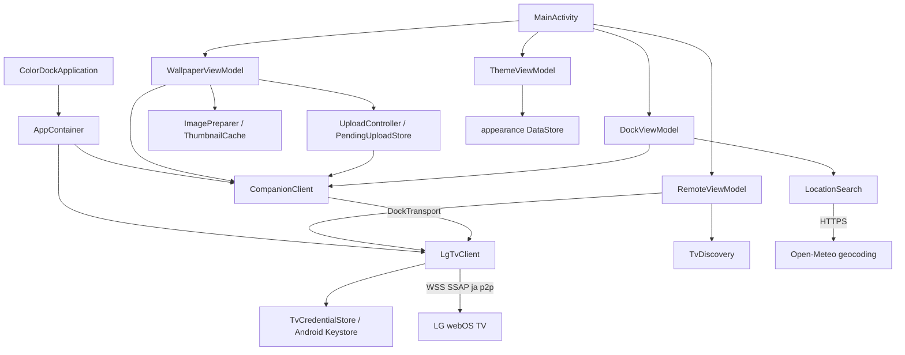
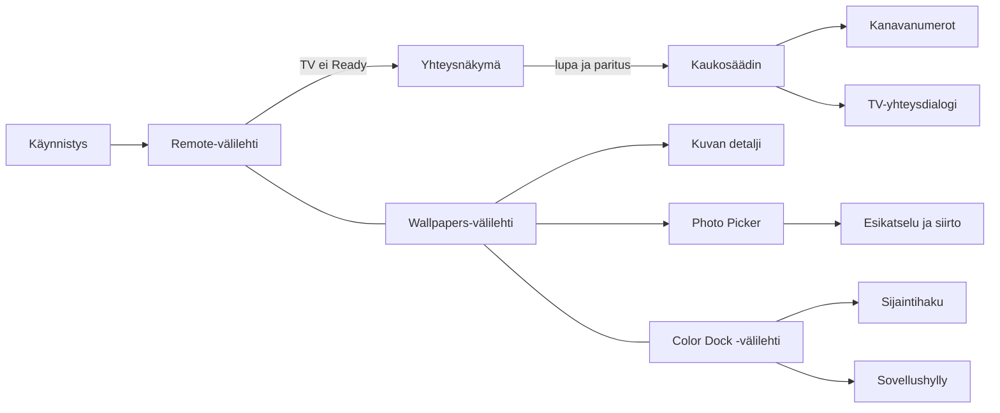

# Remote — sovelluksen tekninen viite

Tämä dokumentti kuvaa **tämän repositorion toteutusta**, sen käyttöliittymää, tiedonkulkua, testejä ja kehityksen rajoja. Se on perehdytys- ja katselmointiviite. Lähdekoodi on aina ensisijainen, jos dokumentti ja toteutus eroavat.

**Tutkittu 22.10.2026.** Haara: `codex/initial-import`. Commit: `bf75ada13c05d75d2a4847f708fbeb34b84c1453`. Työpuu oli tutkimuksen alussa puhdas; tämä dokumentti lisättiin sen jälkeen. Tutkimuksessa luettiin kaikki 29 `main`-lähdejoukon Kotlin-tiedostoa, debug-diagnostiikka, kaikki 21 testien Kotlin-tiedostoa, protokollafixture, manifestit, Gradle-määritykset ja tekstimuotoiset resurssimääritykset. Kuvavarat inventoitiin; sovelluksen ulkoasua ei tässä työssä varmennettu näyttökaappauksilla tai laiteajolla.

**Rajattu päivitys 26.10.2026:** TV apps -pikavalinnat toteutettiin haaralla `codex/streaming-app-plan` säilyttäen aiempi keskeneräinen työ. Tämän ominaisuuden nykyinen toteutus ja ajetut tarkistukset on kuvattu [validointiraportissa](docs/validation/streaming-app-shortcuts.md). Alla olevat 22.10. tutkimuksen testimäärät, versiot ja yleiset todentamisrajat ovat historiallinen snapshot, ellei kohtaa ole erikseen päivitetty. Fyysinen TV ja puhuttu TalkBack ovat tämänkin ominaisuuden osalta vielä varmentamatta.

Merkintätapa:

- **Toteutettu:** lähdekoodista todettu toiminta; ei automaattisesti laitteella varmennettu.
- **Testilähde:** olemassa oleva testi ja sen todelliset tarkistukset; ei väite läpäistystä ajosta.
- **Varmennettava riski:** havaittuun koodiin perustuva mahdollinen ongelma, jonka vaikutus tarvitsee kohdennetun testin tai ajon.
- **Ei saatavilla:** asiaa ei voi ratkaista tämän repositorion sisällöstä.

Tässä dokumentointityössä ei ajettu Gradle-käännöstä, yksikkötestejä, instrumentaatiotestejä, ulkoista palvelua tai fyysistä TV:tä. Dokumentin tarkastukset käsittävät lähdeviitteet, rakenteen ja muutoksen rajauksen. Sovelluskoodia, asetuksia, riippuvuuksia, resursseja tai testejä ei muutettu.

## Sisällys

- [A. Identiteetti ja nykytila](#a-identiteetti-ja-nykytila)
- [B. Toimintoinventaario](#b-toimintoinventaario)
- [C. Arkkitehtuuri ja alustaminen](#c-arkkitehtuuri-ja-alustaminen)
- [D. Käyttöliittymän viite](#d-kayttoliittyman-viite)
- [E. Navigointi ja käyttäjäpolut](#e-navigointi-ja-kayttajapolut)
- [F. Tila, elinkaari ja rinnakkaisuus](#f-tila-elinkaari-ja-rinnakkaisuus)
- [G. Tietomallit ja pysyvyys](#g-tietomallit-ja-pysyvyys)
- [H. Yhteydet ja ulkoiset integraatiot](#h-yhteydet-ja-ulkoiset-integraatiot)
- [I. Maksaminen ja käyttöoikeudet](#i-maksaminen-ja-kayttooikeudet)
- [J. Android-luvat, tietoturva ja yksityisyys](#j-android-luvat-tietoturva-ja-yksityisyys)
- [K. Työkalut ja riippuvuudet](#k-tyokalut-ja-riippuvuudet)
- [L. Kielet ja muotoilu](#l-kielet-ja-muotoilu)
- [M. Saavutettavuus ja laiteyhteensopivuus](#m-saavutettavuus-ja-laiteyhteensopivuus)
- [N. Testaus ja laadunvarmistus](#n-testaus-ja-laadunvarmistus)
- [O. Kehitys, kääntäminen ja julkaisu](#o-kehitys-kaantaminen-ja-julkaisu)
- [P. Virheet ja rajatapaukset](#p-virheet-ja-rajatapaukset)
- [Q. Todetut rajoitteet ja tarkistettavat riskit](#q-todetut-rajoitteet-ja-tarkistettavat-riskit)
- [R. Koodikatselmoinnin kohdekartta](#r-koodikatselmoinnin-kohdekartta)
- [S. Lähdekoodin viitekartta](#s-lahdekoodin-viitekartta)
- [T. Avoimet kysymykset ja näytön rajat](#t-avoimet-kysymykset-ja-nayton-rajat)
- [U. Ohjeet seuraavalle kehittäjälle ja AI-avustajalle](#u-ohjeet-seuraavalle-kehittajalle-ja-ai-avustajalle)

<a id="a-identiteetti-ja-nykytila"></a>
## A. Identiteetti ja nykytila

| Asia | Repositoriosta todettu arvo tai toiminta |
| --- | --- |
| Käyttäjälle näkyvä nimi | `Remote`, resurssi `app_name` |
| Gradle-juuriprojekti | `Remote` |
| Moduulit | Ainoastaan Android-sovellus `:app` |
| Namespace ja application ID | `com.emmah.colordock.remote` |
| Versio | `versionName = "1.0.0"`, `versionCode = 1` |
| Android-rajaus | `minSdk = 37`, `targetSdk = 37`, `compileSdk = 37`; alemmille API-tasoille ei ole tuettua varianttia |
| Käyttöliittymä | Kotlin ja Jetpack Compose Material 3, yksi `MainActivity` |
| TV-kohde | LG webOS -TV:n paikallisverkon SSAP/WebSocket-rajapinta |
| Erillinen TV-sovellus | Color Dock, sovellustunnus `com.emmah.colordock` |
| Käyttäjä ja tarkoitus | LG-TV:n käyttäjä, joka haluaa ohjata TV:tä puhelimella sekä hallita Color Dockin kuvia, kelloa, säätä ja sovellushyllyä |
| Julkaisutila | Ei todettavissa: versionumero ei osoita julkaistua sovellusta, allekirjoitettua pakettia tai Play Console -tilaa |

Lähteet: [settings.gradle.kts](settings.gradle.kts), [app/build.gradle.kts](app/build.gradle.kts), [AndroidManifest.xml](app/src/main/AndroidManifest.xml), [strings.xml](app/src/main/res/values/strings.xml), [MainActivity.kt](app/src/main/java/com/emmah/colordock/remote/MainActivity.kt).

Sovellus löytää TV:n paikallisverkosta tai hyväksyy sen yksityisen IP-osoitteen. Käyttäjä sallii paikallisverkkoluvan Androidissa ja ensimmäisen parituksen TV:ssä. Tavallista TV-ohjausta varten Color Dockin ei tarvitse olla käynnissä. Taustakuvien ja Color Dockin asetusten hallinta vaatii erillisen TV-sovelluksen ja sen yhteensopivan companion-protokollan.

Puhelimeen tallentuvat paritustiedot, ulkoasuteema, pikkukuvavälimuisti ja keskeneräisen kuvansiirron pieni palautumistieto. Varsinainen kuvakirjasto ja Color Dockin asetukset ovat TV:n vastuulla. Android-repo ei sisällä TV-palvelimen toteutusta eikä taustapalvelinta.

Toteutettuja ovat kolme päävälilehteä, paritus ja automaattinen uudelleenyhdistys, TV-ohjaus, TV:ltä löydetyt sovelluspikavalinnat ja All apps -valitsin, kanavanumeron valinta, kuvagalleria ja kuvansiirto, kellotilan ohjaus, paikkahaku, sovellushyllyn muokkaus ja kaksi puhelimen teemaa. Sovelluspikavalintojen rajaus on [toteutussuunnitelmassa](docs/superpowers/plans/2026-10-26-streaming-app-shortcuts.md).

<a id="b-toimintoinventaario"></a>
## B. Toimintoinventaario

Tässä taulukossa testit tarkoittavat olemassa olevaa testilähdettä. Testien tarkemmat rajat ovat [osassa N](#n-testaus-ja-laadunvarmistus). Kaikki TV-toiminnot kulkevat paikallisverkkoyhteyden kautta; tavallinen ohjaus edellyttää `TvConnectionState.Ready`, companion-toiminnot lisäksi käyttökelpoista Color Dock -istuntoa.

| Toiminto ja pääsy | Toteutus ja tietoriippuvuus | Tilat, rajat ja palautuminen | Testit |
| --- | --- | --- | --- |
| TV:n etsintä: Remote → Find TVs | `RemoteViewModel.find` → `TvDiscovery.find`; SSDP ja TV:n kuvaus-XML | Paikallisverkkolupa; Wi-Fi/Ethernet; tyhjä lista, hakupalkki, enintään 16 osoitetta; käsin annettu osoite vaihtoehtona | `TvDiscoveryTest`; lomakkeen tavoitettavuus `ConnectionScreenTest` |
| Käsin yhdistäminen ja TV-paritus: Remote → IP → Connect TV | `TvTarget.parse` → `LgTvClient.connect` → TLS, hello, register, `TvCredentialStore.save` | Vain sallittu IP-literaali; TV:n hyväksyntä; 60 s rekisteröintiaikaraja; varmenne- ja laitetunnisteen muutos hylätään | `TvEndpointPolicyTest`, `TvCertificateTrustTest`, `LgTvClientTest`; laiteportti `DeviceGateTest` |
| Tallennettuun TV:hen palaaminen | `RemoteViewModel.foreground`, `reconnectSaved`, `recover` | Automaattinen yritys tallennettuun osoitteeseen; enintään viisi palautumisyritystä; paritus- ja identiteettivirheet pysäyttävät automatiikan | Ei koko ViewModelin palautumissilmukan testiä |
| Yhteysvalikko: yhdistetyn TV:n nimi | `MainActivity`-dialogi: Reconnect ja Forget TV | Forget sulkee yhteyden, hylkää kuvavalinnan ja poistaa paikallisen parituksen; ei poista TV:n kuvia | Tallennuksen poisto `TvCredentialStoreTest`; valikon kokonaispolulle ei omaa testiä |
| Suunnat, OK, Back, LG Home, TV Guide | `RemoteScreen` → `RemoteViewModel` → `LgTvClient.send` → `PointerInputClient` | TV:n fokuksen ohjaus; suunnissa painalluksen toisto; Guide-merkkilippu ei ole laitekyvykkyyden mittaus | `PointerInputClientTest`, `RemoteViewModelTest`, `RemoteScreenTest` |
| Äänenvoimakkuus, mute/unmute ja kanava ylös/alas | `LgTvClient` SSAP-komennot; mute ja nykykanava tilauksina/päivityslukuina | Mute-tila voi olla tuntematon; tällöin toiminto on Mute sound; ääni- ja kanavapainikkeet toistuvat | Toisto- ja UI-testit; ei kaikkien komentojen TV-vastetestistöä |
| Live TV ja numerovalitsin | `NumberPadSheet` hakee tarkan numerovastaavuuden TV:ltä saatuun `TvChannel`-listaan; `tune` avaa Live TV:n ja kanavan | Enintään viisi numeroa; ei suorien numeronäppäinten lähettämistä TV:lle; päällekkäiset numerot vaativat kanavan valinnan | `RemoteScreenTest.duplicateChannelNumbersRequireExplicitChoiceAndDigitsStayLocal` |
| TV apps -pikavalinnat ja All apps | `TvAppsController` → `LgTvClient.apps/launchApp`; asennuslista ja launch-point-metadata | Haku Ready-istunnossa ja Refreshillä/valitsimen avauksessa; myös tuntemattomat sovellukset; yksi avauspyyntö, paikalliset virheet, ei companion-riippuvuutta | `TvAppsTest`, `TvAppsControllerTest`, `TvAppsTransportTest`, `TvAppsScreenTest`, `AppIconCacheTest`; fyysinen TV avoinna |
| TV:n sammutus | Power-painike → vahvistus → `system/turnOff` | Peruuttaminen ei lähetä komentoa; lähetysyritys estää automaattisen uudelleenyhdistyksen; ei käynnistystä tai Wake-on-LAN-toimintoa | `RemoteScreenTest.powerRequiresConfirmationAndPhoneBackDoesNotSendTvBack` |
| Color Dockin avaaminen | Remote → Color Dock tai companion-näkymän Open Color Dock → `launchColorDock` | TV-sovellus käynnistetään vain eksplisiittisestä toiminnosta; onnistuneen käynnistysvastauksen jälkeen enintään kolme liittymisyritystä | UI:n eksplisiittinen avaus ja `CompanionClientTest`; todellinen käynnistys tarvitsee TV:n |
| TV:n kuvien selaaminen | Wallpapers → My pictures / Built-in → `WallpaperViewModel.load`; `gallery.list`, `gallery.thumbnail` | 24 metatietoa sivupyyntöä kohden; omissa kuvissa Load more; sisäänrakennettu luettelo luetaan kaikkiin kokoelmasuodattimiin; pikkukuvat laiskasti | Kokoelmasuodatus `CompanionScreensTest`; ei ViewModelin sivutustestiä |
| Kuvan käyttö, shuffle-valinta ja sovitus | Gallerian kuva → detalji → `Use`, `DockPatch.Wallpaper`, henkilökohtaiselle kuvalle `Fit` | Muutokset käyttävät `expectedRevision`-arvoa; TV:n tyhjän valinnan virhe näytetään; cover/contain henkilökohtaisille kuville | Protokollan patch-fixture; detaljitoiminnoille ei kattavaa UI-testistöä |
| Henkilökohtaisen kuvan poisto | Detalji → Delete from TV → vahvistus → `wallpaper.delete` | Vain `user:`-alkuisille kuville; alkuperäistä puhelimen kuvaa ei poisteta; virhe näytetään detaljissa | Poistolle ei omaa UI-/palvelintestiä |
| Shuffle-tila ja vaihtumishetki | Wallpapers → Shuffle selected / Shuffle options | `fixed` tai `shuffle`; trigger `open` tai `start`; Next wallpaper erillinen komento | `CompanionScreensTest.shuffleOptionsKeepNextAndTriggerReachable` |
| Kuvien tuonti puhelimesta | Add from phone → Android Photo Picker → esikatselu → Send to TV | Enintään 10 kuvaa; esikäsittely, cover/contain, per-kuva-virheet, peräkkäinen siirto, Cancel upload, Retry failed | `ImagePreparerTest`, `UploadControllerTest`; koko picker–TV-polku varmentamatta |
| Katkenneen siirron tuloksen selvittäminen | Companion-yhteyden uudelleenliittyminen → `PendingUploadStore.read` → `upload.status` | Ilmoittaa tallentuiko edellinen kuva; ei jatka tavusiirtoa prosessikuoleman jälkeen; keskeneräinen kuva valitaan uudelleen | Journalin säilyminen `UploadControllerTest`; ei prosessikuoleman E2E-testiä |
| TV:n kellotila | Color Dock → Start/Stop clock mode; Start automatically | `clock.start`/`clock.stop`; idleMinutes 0, 5, 10, 30; puhelimen kellonäkymä on paikallinen esikatselu | `CompanionScreensTest`; varsinaista TV-ajastinta ei ole tässä repossa |
| TV:n sää ja sijainti | Color Dock → Show weather / Location → Choose location → Search | Manuaalinen paikkahaku Open-Meteolta; valinta lähettää koordinaatit ja aikavyöhykkeen TV:lle; ei GPS-lupaa | Käyttöliittymän switch-semantiikka; HTTP-haulle ei omaa testiä |
| TV:n sovellushylly | Color Dock → Edit app shelf → näkyvyys/järjestys → Save | Kahdeksan tunnettua sovellustunnusta; vähintään yksi näkyviin; luonnoksella alkuperäinen revisio; Cancel hylkää luonnoksen | `CompanionScreensTest.staleShelfDraftKeepsOriginalRevisionAndCannotHideEveryApp`, rajallinen tarkistus |
| Puhelimen teema | Päätason näkymän Settings → Warm light / Soft dark | Paikallinen DataStore; toimii ilman TV-yhteyttä; ei järjestelmän mukaan vaihtuvaa teemaa | `ThemeTest`, `ThemeSettingsTest`, `DesignCaptureTest` |
| Käynnistys ja brändäys | Android-launcher → `MainActivity.configureSplash` | Adaptive icon, lyhyt poistumisanimaatio; animaatioiden poiskytkentä huomioitu | `LauncherTest`; animaation ajoitusta ei testata |

Sovelluksessa ei ole käyttäjätilejä, kirjautumista, ostamista, mainoksia, käyttöhistoriaa, pilvivarmuuskopiointia, ilmoituksia, ajastettua taustatyötä, puhelimeen tehtävää kuvien vientiä eikä erillistä onboarding-karusellia. Ensikäytön opastus on yhteysnäkymän teksteissä ja käyttöjärjestelmän lupapyynnössä. Näiden poissaolo perustuu manifestien, riippuvuuksien ja kaikkien sovelluslähteiden tutkimiseen.

<a id="c-arkkitehtuuri-ja-alustaminen"></a>
## C. Arkkitehtuuri ja alustaminen

### Moduuli- ja pakettikartta

| Polku | Vastuu |
| --- | --- |
| `app/src/main/java/com/emmah/colordock/remote/` | Application, riippuvuussäiliö ja ainoa tuotanto-Activity |
| `…/ui/` | Compose-näkymät, neljä AndroidViewModelia, teema ja UI-tilamallit |
| `…/tv/` | IP-politiikka, LAN-etsintä, TLS-paritus, SSAP-istunto, näppäinkanava ja paritustallennus |
| `…/companion/` | Color Dock -protokolla, mallit, patchit, request/reply-korrelointi ja kuvansiirto |
| `…/images/` | Kuvien valmistelu ja TV:n pikkukuvien levypohjainen välimuisti |
| `…/weather/` | Julkisen geokoodauspalvelun paikkahaku |
| `app/src/main/res/` | Englanninkieliset perusmerkkijonot, ikonit, launcher, splash ja varmuuskopioinnin estot |
| `app/src/debug/` | Turvallisesti tiivistävä `ConnectionProbe` ja Compose-testihostin teemaylikirjoitus |
| `app/src/test/` | JVM-testit ja companion-protokollafixture |
| `app/src/androidTest/` | Compose-, Android-tallennus-, kuvanvalmistelu- ja siirtotestit sekä erikseen aktivoitavat TV-portit |
| `gradle/` | Versiokatalogi ja wrapper |

Toteutus on ViewModel-vetoinen Compose-sovellus: UI kerää tilavirtoja ja kutsuu ViewModelien tapahtumametodeja. Erillistä domain-moduulia, use case -kerrosta, repository-rajapintakerrosta, Navigation Composea tai Hilt/Koin-riippuvuudeninjektiota ei ole. `TvControl`, `DockControl` ja `DockTransport` ovat protokollan rajapintoja; tuotanto-ViewModelit hakevat konkreettiset asiakkaat Applicationin säiliöstä. Tätä ei pidä kuvata täydellisenä Clean Architecture -toteutuksena.



### Käynnistysjärjestys

1. Manifesti luo [ColorDockApplication](app/src/main/java/com/emmah/colordock/remote/ColorDockApplication.kt). `onCreate` poistaa `cacheDir/uploads`-hakemiston suorat tiedostot. `container` syntyy laiskasti.
2. [AppContainer](app/src/main/java/com/emmah/colordock/remote/AppContainer.kt) luo yhden `LgTvClient`- ja yhden `CompanionClient`-olion. Companionin keräilijöiden scope on `SupervisorJob() + Dispatchers.Main.immediate`, sovellusprosessin mittainen.
3. [MainActivity](app/src/main/java/com/emmah/colordock/remote/MainActivity.kt) omistaa `ThemeViewModel`, `RemoteViewModel`, `WallpaperViewModel` ja `DockViewModel` -instanssit `by viewModels()` -delegaatilla. Se asentaa splash-poistumisanimaation ja edge-to-edge-asetukset sekä palauttaa lupapyynnön jatkotiedot Bundlesta.
4. Compose-sisältö odottaa, kunnes `ThemeViewModel.theme` ei enää ole `null`. Tallennuslukuvirheessä valitaan Soft dark ja säilytetään virheteksti asetuksia varten.
5. `RemoteViewModel` lukee tallennetun osoitteen ja reagoi foreground-tilaan. Ensimmäinen päävälilehti on Remote. `Ready` näyttää kaukosäätimen; muut TV-tilat näyttävät yhteysnäkymän.
6. Companion-välilehdelle siirtyminen valmiin TV-yhteyden aikana kutsuu `WallpaperViewModel.join`. Tämä koskee myös Color Dock -välilehteä. TV-sovellusta ei automaattisesti käynnistetä.

Sovelluksessa ei ole omaa Serviceä, WorkManageria, BroadcastReceiveriä tai ContentProvideria. Tämä tarkoittaa sovelluksen **itse ilmoittamia** komponentteja; riippuvuuksien yhdistettyä manifestia ei tarkistettu tässä työssä.

<a id="d-kayttoliittyman-viite"></a>
## D. Käyttöliittymän viite

### Näkymät ja tilan omistajat

| Näkymä | Toteutus ja omistaja | Sisältö ja siirtymät |
| --- | --- | --- |
| Sovelluskehys | `RemoteAppShell` / `MainActivity` | Material 3 `Scaffold`, alhaalla aina Remote, Wallpapers, Color Dock; valittu välilehti `rememberSaveable` |
| Yhteys | `ConnectionScreen` / `RemoteViewModel`, Activityn lupatila | Otsikko ja Settings; verkko-ohjeet; Find TVs; löydetyt TV-kortit; IP-kenttä; Connect/Reconnect; lupa-asetuksiin siirtyminen; tila/virhe ja tarvittaessa Cancel |
| Kaukosäädin | `RemoteScreen` / `RemoteViewModel` | TV:n nimi/yhteysvalikko, Settings, virta; LG Home / Color Dock; nykykanava; suuntaympyrä; Back / TV Guide; kapeiden keinujen keskellä Mute, Numbers, Live TV ja All apps; viimeisenä TV apps -rivi. Kapealla näytöllä tai suurella fontilla leveät keinut ja pinoutuvat toimintoparit. |
| Sovellusvalitsin | `TvAppsSheet` / `TvAppsController` | Avattu Material 3 -alalehti, Refresh ja Close; mukautuva ruudukko tai suurella fontilla rivit; täydet nimet, alkuperäiset kuvakkeet, avausvirheen Retry. Phone Back sulkee paikallisesti; hyväksytty avaus sulkee valitsimen. |
| Kanavanumerot | `NumberPadSheet` / paikallinen `rememberSaveable` | Täysin avautuva `ModalBottomSheet`, read-only numerokenttä, 1–9 ruudukko, leveä 0 ja Delete, moniselitteisten kanavien valinta, tune ja Cancel |
| Kuvagalleria | `WallpaperScreen` / `WallpaperViewModel` + `DockState` | Nykykuva, Add from phone, My pictures/Built-in, kokoelmasuodatin, ruudukko, Load more ja shuffle-asetukset |
| Kuvan detalji | `WallpaperScreen`-haara / `WallpaperUiState.detail` | Paluu Wallpapersiin, nimi, 16:9-esikatselu, Use wallpaper, shuffle-jäsenyys, henkilökohtaisen kuvan fit ja poisto |
| Tuonnin esikatselu / siirto | `WallpaperScreen`-haara / `WallpaperUiState` | Kuvalista, fit-valinnat, valmistelu- ja siirtopalkit, vaihe, lopputulos, Send to TV / Retry failed / Cancel upload / Cancel |
| Color Dock -etusivu | `DockScreen`, `DockViewModel`, jaettu `DockState` | Kellon paikallinen esikatselu, kellotilan start/stop, automaattinen käynnistysaika, sää ja sijainti, Edit app shelf |
| Sijaintihaku | `DockScreen`, `page = "location"` / `DockUiState` | City or place, Search, lataus, tyhjä tulos, paikkakortit, virhe ja Open-Meteo-attribuutio |
| Sovellushyllyn muokkaus | `AppShelfScreen`, `page = "shelf"` | Näkyvien sovellusten tekstiesikatselu, sovelluskortit, näkyvyyskytkimet, Move up/down, Save ja Cancel |
| Puhelimen asetukset | `ThemeSettings` / `ThemeViewModel` | AlertDialog, App theme, Warm light ja Soft dark radio-riveinä, virhe ja Done |

Lähteet: [RemoteTab.kt](app/src/main/java/com/emmah/colordock/remote/ui/RemoteTab.kt), [ConnectionScreen.kt](app/src/main/java/com/emmah/colordock/remote/ui/ConnectionScreen.kt), [RemoteScreen.kt](app/src/main/java/com/emmah/colordock/remote/ui/RemoteScreen.kt), [NumberPadSheet.kt](app/src/main/java/com/emmah/colordock/remote/ui/NumberPadSheet.kt), [WallpaperScreen.kt](app/src/main/java/com/emmah/colordock/remote/ui/WallpaperScreen.kt), [DockScreen.kt](app/src/main/java/com/emmah/colordock/remote/ui/DockScreen.kt), [ThemeSettings.kt](app/src/main/java/com/emmah/colordock/remote/ui/ThemeSettings.kt).

### Dialogit, valikot ja palaute

- **Yhteysdialogi:** TV:n nimi, Connected/TV unavailable, Reconnect, Forget TV, Close. Vain yhdistetyn kaukosäätimen otsikko tarjoaa sen avaamisen.
- **Yleinen TV-virhedialogi:** otsikko Connection, `RemoteViewModel.error`, Close. Erillinen yhteysnäkymän virheteksti tulee `TvState.message`-kentästä.
- **Sammutusvahvistus:** Turn off the TV?, Turn off ja Cancel.
- **Kuvan poistovahvistus:** täsmentää puhelimen alkuperäisen kuvan säilyvän; Delete ja Cancel.
- **Shuffle options:** vaihtumishetken pudotusvalikko, Next wallpaper, Done.
- **ChoiceRow:** yhteinen valintapainike ja `DropdownMenu`; käytössä fitille, kokoelmalle, shuffle-triggerille ja kellon automaattiajalle.
- **DockUnavailable:** companion ei valmis tai snapshot puuttuu; Connectingin oma teksti, mahdollinen virhe, Open Color Dock ja Try again. Sama wallpaper-painotteinen teksti esiintyy myös Color Dock -näkymässä.
- Ei omaa SnackbarHostia, toast-kerrosta, drawer-valikkoa tai navigointireittien siirtymäanimaatioita.

Yhteyslomake estää Find TVs/Connect-toiminnot etsinnän, yhdistämisen, parituksen tai palautumisen aikana. Tyhjä osoite ei kelpaa Connectiin, mutta varsinainen IP-tarkistus tehdään vasta Activityn yhdistämiskäsittelijässä. Kanavanumero ei ole vapaasti kirjoitettava kenttä; sitä muodostetaan paikallisesti omalla näppäimistöllä. Sijaintihaku vaatii UI:ssa vähintään kaksi merkkiä; palvelukerros tarkistaa myös 120 merkin ylärajan.

Galleria käyttää latauspalkkia, lähdekohtaista tyhjän tilan tekstiä ja virheriviä. Puuttuvan tai epäonnistuneen pikkukuvan kohdalla `Picture` näyttää kuvaikonin; esikatseluvirheelle ei ole omaa virhedialogia. TV:lle tehtävissä asetuksen muutoksissa `saving` estää useita ohjaimia, mutta esto ei ole yhtenäinen kaikissa korteissa ja kaikissa alisivuissa.

### Kaukosäätimen geometria ja painallukset

`RemoteScreen` on vieritettävä sarake: sivupadding 16 dp, ylätila 8 dp, alatilaa 24 dp ja elementtiväli 12 dp. `DirectionPad` on 220 dp:n ympyrä, keskellä 88 dp:n OK ja sivuilla 64×72/72×64 dp:n suuntapainikkeet. Canvas piirtää vinot erotinviivat. Ääni- ja kanavakeinuissa on ikonit ja 48 dp:n plus/miinus-painikkeet; näkyviä Volume/Channel-otsikoita ei ole, nimet tulevat semantiikkaan.

`RemoteKey` käsittelee toistuvien komentojen kosketuksen `PointerEventPass.Initial`-vaiheessa: se kuluttaa alas/ylös-tapahtumat ja kutsuu `onPress`/`onRelease`. Normaali `onClick` säilyy semanttiselle aktivoinnille. Fokuksen menetys ja näkymän poistuminen vapauttavat toiston. Tämä on painikenäppäimistö, ei hiiren osoittimen liikutuspinta tai eleohjattu touchpad.

`AdaptivePair` pinoaa kaksi toimintoa, jos käytettävä leveys on alle 300 dp tai fonttiskaala yli 1,4. Muulloin ne ovat samalla rivillä. Muutos ei koske kaikkia rivejä, esimerkiksi ääni- ja kanavakeinut säilyvät rinnakkain.

### Kuvien ja Color Dockin esitys

Galleria on `LazyVerticalGrid(GridCells.Adaptive(140.dp))`, ulkopadding 16 dp, ruutuvälit 8 dp. Nykykuvan suhde on 2,8:1, galleriaruudun 2,25:1 ja detalji-/tuontiesikatselun 16:9. Korttien säteet ovat tyypillisesti 12 tai 14 dp. Shuffle-jäsenyys näkyy reunavärinä, check-ikonina ja `stateDescription`-tekstinä. Kuvan `cover` käyttää `ContentScale.Crop`-asetusta ja `contain` `ContentScale.Fit`-asetusta.

`Picture` dekoodaa tiedoston `produceState`-korutiinilla IO-dispatcherissa ja näyttää kuvalle sisältökuvauksen. Sovellus ei käytä Coil/Glide-kirjastoa. TV:ltä haettuja pikkukuvia käytetään myös detaljin ja kellon esikatselussa; puhelin ei lataa TV:ltä alkuperäistä täysikokoista kuvaa.

Color Dockin kellokortti on 2,2:1. Se näyttää **puhelimen** `LocalTime.now()`-ajan kerran sekunnissa päivittyvänä `HH:mm`-tekstinä, ei TV:n ajan tai haetun sääpaikan aikavyöhykkeen mittausta. Start/Stop-painikkeen tila tulee TV:n `clockActive`-arvosta.

Sovellushyllyn kahdeksan nimeä ja tunnusta ovat kovakoodattuja `shelfApps`-listassa:

| Nimi | TV-sovelluksen tunnus |
| --- | --- |
| YouTube | `youtube.leanback.v4` |
| Netflix | `netflix` |
| HBO Max | `com.wbd.stream` |
| Viaplay | `viaplay-lg` |
| Yle Areena | `fi.yle.areena` |
| MTV Katsomo | `mtvkatsomo` |
| Ruutu | `fi.nelonenmedia.ruutu` |
| Plex | `cdp-30` |

Lista ei ole asennettujen TV-sovellusten kyselyn tulos. Androidissa muokataan hyllyn järjestystä ja näkyvyyttä; tästä näkymästä ei käynnistetä listan sovelluksia.

### Teemat ja design-arvot

[AppTheme.kt](app/src/main/java/com/emmah/colordock/remote/ui/AppTheme.kt) määrittää kaksi kokonaista Material 3 -väriskeemaa. `AppTheme.fromStored` palauttaa puuttuvalle tai tuntemattomalle arvolle SoftDarkin. Järjestelmäteeman seurantaa tai dynaamisia taustakuvavärejä ei ole.

| Arvo / rooli | Warm light | Soft dark |
| --- | --- | --- |
| `background` / `onBackground` | `#FFFCF2` / `#252422` | `#252422` / `#FFFCF2` |
| `surface` / `onSurface` | `#EFEAE0` / `#252422` | `#403D39` / `#FFFCF2` |
| `onSurfaceVariant` | `#403D39` | `#CCC5B9` |
| `primary` / `onPrimary` | `#A63C12` / `#FFFCF2` | `#FF9B75` / `#252422` |
| `primaryContainer` / `onPrimaryContainer` | `#EB5E28` / `#252422` | `#EB5E28` / `#252422` |
| `outlineVariant` | `#CCC5B9` | `#5C5750` |
| `error` | `#B3261E` | `#FFB4AB` |
| `surfaceTint` | Läpinäkyvä | Läpinäkyvä |

Yhteiset nimet ovat `OrchidWhite`, `ChromeWhite`, `Masala`, `WarmBlack`, `Vermillion`. `Typography()` käyttää Materialin oletuksia; vain `headlineSmall.fontWeight` muutetaan SemiBoldiksi. Mukautettua fonttiperhettä, fonttitiedostoja tai keskitettyä spacing-/shape-token-järjestelmää ei ole. Kokoja määritellään suoraan composableissa. Käytössä ovat Material 3:n painikkeet, kortit, Surface, dialogit, kytkimet, radio-rivit, segmented buttons, valikot ja bottom sheet.

Väristä riippumattomia kiinteitä poikkeuksia ovat yhteysilmaisimen vihreä/punainen piste, kuvien päällä olevat WarmBlack/OrchidWhite-peitteet sekä tumma splash. [launch.xml](app/src/main/res/values/launch.xml) määrittää splash-taustan `#252422`, tekstin `#FFFCF2` ja launcher-oranssin `#E96621`.

### Ikonit, varat, liike ja ikkunat

- `res/drawable` sisältää 24 `ic_*.xml`-vektoria: 23 yhden polun Material Symbols -ikonia 960×960-viewportilla ja erillisen 24×24-viewportin `ic_settings`-ikonin. `DockIcon` käyttää `painterResource`a ja lisää 24 dp:n size-modifierin. Joissakin kutsupaikoissa on lisäksi oma kokomääritys, esimerkiksi RemoteKeyssä 34 dp; lopullinen asettelu riippuu modifier-ketjun rajoitteista.
- [ic_launcher.xml](app/src/main/res/mipmap-anydpi/ic_launcher.xml) käyttää adaptive iconin taustaväriä ja [launcher_artwork.xml](app/src/main/res/drawable/launcher_artwork.xml)-insettiä. Insetti viittaa [remote_artwork.png](app/src/main/res/drawable-nodpi/remote_artwork.png)-kuvaan ja käyttää 20 %:n reunoja. Tässä dokumentissa ei päätellä PNG:n piirrosaihetta.
- [Material Symbols -lisenssi](app/src/main/assets/material-symbols-LICENSE.txt) on Apache License 2.0. Se ei itsessään ole koko repositorion tai muiden kuvien lisenssiselvitys.
- Kuusi WebP-kuvaa `app/src/androidTest/assets/design/`-hakemistossa ovat design-testien aineistoa; ne eivät ole tuotantosovelluksen TV-taustakuvakirjasto.
- Splashin ikoni skaalautuu 0,94 → 1 ja siirtyy 8 dp; nimen alpha/siirtymä ja koko splashin häivytys päättävät noin 500 ms:n poistumisen. `ValueAnimator.areAnimatorsEnabled()` ohittaa animaation, kun animaatiot on poistettu käytöstä. `onStop` siivoaa keskeneräisen splashin.
- `MainActivity` käyttää `enableEdgeToEdge`a, läpinäkyviä palkkeja ja teeman mukaisia vaaleita/tummia järjestelmäkuvakkeita. Navigation bar contrast enforcement poistetaan käytöstä. `RemoteAppShell` välittää Scaffoldin paddingin sisältöön; omaa IME-inset-/näppäimistöohjausta ei ole.
- Manifestissa ei lukita orientaatiota eikä ilmoiteta omaa `configChanges`-käsittelyä. Ei erillistä landscape-/tablet-/foldable-asettelua tai ikkunakokoluokkia. Leveällä näytöllä galleria lisää sarakkeita, mutta pääsarakkeilla ei ole enimmäisleveyttä.

<a id="e-navigointi-ja-kayttajapolut"></a>
## E. Navigointi ja käyttäjäpolut

Navigointi on ehdollista Compose-sisältöä, ei route/NavController-pinoa. `RemoteTab`-enumissa on kolme arvoa. `MainActivity` säilyttää valitun välilehden, asetusten ja yhteysdialogin aukiolon sekä virheellisen osoitteen lipun `rememberSaveable`lla. Alinavigaation käyttö vapauttaa pitkän painalluksen; välilehden vaihtaminen ei itsessään lähetä TV-näppäinkomentoa. Companion-välilehdelle tulo voi silti lähettää liittymis- ja tilakyselyjä.



### Merkitykselliset polut

1. **Ensikäyttö:** tumma oletusteema latautuu → Remote-yhteysnäkymä → Find TVs tai IP → `ACCESS_LOCAL_NETWORK`-pyyntö → odottava haku/yhdistäminen jatkuu myönnöstä → TLS/TV:n paritusprompt → tallennus → kanavalista ja tila → kaukosäädin. TV:n hyväksynnälle ei ole erillistä Androidin PIN-lomaketta.
2. **Luvan epääminen:** `permissionDenied` tuottaa PermissionRequired-näkymän. Kun lupaa on pyydetty eikä Android suosittele rationalea, Open settings avaa sovelluskohtaiset Android-asetukset. Paluu tarkistaa luvan `onStart`issa; avoin manuaalinen yhdistys ei automaattisesti jatku asetuksista palaamisen perusteella ilman uutta toimintoa tai tallennetun yhteyden automatiikkaa.
3. **Päivittäinen käyttö:** tallennettu osoite luetaan → foreground yrittää yhdistää → TV:n olemassa olevaa client keytä käytetään → käyttäjä ohjaa ääntä, kanavaa tai fokusta. Numerovalitsin lähettää vasta lopullisen valitun kanavatunnuksen.
4. **Color Dock:** käyttäjä siirtyy companion-välilehdelle → `join` yrittää kanavaa → tarvittaessa Open Color Dock käynnistää TV-sovelluksen → snapshot kertoo asetukset → muutokset käyttävät tätä tilaa. Companionin puuttuminen ei itsessään katkaise tavallista TV-ohjausta.
5. **Kuvan tuonti:** picker valitsee kuvat → valmistelu näyttää onnistuneet ja virheet → fit voidaan valita kuville → Send to TV → kukin kuva siirretään erikseen → onnistuneet paikalliset tiedostot poistetaan, epäonnistuneet jäävät Retry failed -polulle. Peruuttaminen ei peru TV:lle jo tallentuneita kuvia.
6. **Asetuksen ristiriita:** TV muuttuu toisen ohjaimen kautta → Android lähettää vanhan revision → `REVISION_CONFLICT` → uusi snapshot haetaan ja käyttäjää pyydetään tarkistamaan muutos. Komentoa ei toisteta automaattisesti uudella revisiolla.
7. **Sovellushylly:** avattaessa talteen järjestys, piilotetut ja revisio → paikalliset muokkaukset → Save → vasta palvelimelta palautuva uudempi, täsmäävä tila sulkee editorin. Cancel palaa etusivulle tallentamatta luonnosta.
8. **Taustalle ja takaisin:** ei-konfiguraatiomuutoksen `onStop` peruu aktiivisen kuvansiirron ja pitkät painallukset; TV-yhteys suljetaan viiden sekunnin viiveellä. Nopea paluu peruu sulkemisajastimen. Pitkän tauon jälkeen palautuminen yrittää tallennettua TV:tä, jos automatiikka sallitaan.

### Back ja palautuminen

Puhelimen Back ja TV:n Back ovat eri toimintoja. Vain kaukosäätimen Back lähettää TV:n `BACK`-näppäimen. Dialogit ja bottom sheet käyttävät tavallista sulkemista. Wallpapersin `BackHandler` sulkee ensin detaljin tai hylkää valmistellun kuvajoukon. Pelkkä `preparing = true` ilman yhtään valmistunutta kuvaa ei aktivoi tätä käsittelijää. Color Dockin alisivujen Back palaa `home`-sivulle. Päävälilehtien välille ei ole omaa Back-historiaa.

`rememberSaveable` auttaa Activityn uudelleenluonnissa silloin, kun vastaava rakenne kuuluu tallennettavaan compositioniin. Tässä ei ole välilehtikohtaista `SaveableStateHolder`ia: poistetun alisivun paikallisen tilan säilymistä välilehdenvaihdossa ei pidä olettaa. ViewModelin muistissa oleva Wallpaper-detail/kuvavalinta voi säilyä välilehdenvaihdon yli, koska Activityn ViewModel ei poistu. Prosessikuoleman jälkeen ViewModelin kuvat, listat ja hakutulokset eivät palaudu automaattisesti; pysyvät tiedot luetaan uudelleen.

<a id="f-tila-elinkaari-ja-rinnakkaisuus"></a>
## F. Tila, elinkaari ja rinnakkaisuus

| Omistaja | Julkaistu tila | Päivitys ja elinkaari |
| --- | --- | --- |
| `LgTvClient` | `StateFlow<TvState>`, `dockAvailable`, `SharedFlow<JSONObject>` | WebSocket-callbackit, connect/send/read/disconnect; sovellussäiliössä jaettu |
| `RemoteViewModel` | TV-tila, savedAddress, channels, error, discovered, searching, apps, appIcons | `viewModelScope`; yhteys-, haku-, palautumis- ja taustasulkujobit; `TvAppsController` omistaa sovellusluettelon ja avauksen, kuvapyynnöt tarkistavat istunnon, TV-identiteetin ja luetteloversion |
| `CompanionClient` | `StateFlow<DockState>` | Application-scope kerää TV-/dock-tilaa ja p2p-vastauksia; liittyminen Mutexilla |
| `WallpaperViewModel` | `WallpaperUiState`, `Map<String, File>` thumbnails | listausjob, valmistelu-/siirtojob, valitut URI:t, revision seuranta ja thumbnail-pyyntöjoukko |
| `DockViewModel` | Companion-tila ja `DockUiState` | säähaun job; asetustallennuksen saving/error |
| `ThemeViewModel` | nullable `AppTheme`, error | DataStore-luku aluksi ja kirjoitukset coroutineilla; UI päivittyy onnistuneen kirjoituksen jälkeen |
| Compose/Activity | välilehti, dialogit, sivu, numerot, editoriluonnos, lupaoperaation jatkotiedot | `remember`, `rememberSaveable`, Activity Bundle; ei `SavedStateHandle`a |

[MainActivity](app/src/main/java/com/emmah/colordock/remote/MainActivity.kt) kerää näkyvät tilavirrat `collectAsStateWithLifecycle`lla. Ei LiveDataa, RxJavaa tai yhteistä reduceria. Käyttöliittymän callbackit välittävät komennot ViewModelille; snapshot on companion-asetusten auktoritatiivinen lukutila, ja editoriluonnos on tarkoituksella paikallinen poikkeus.

### TV-ohjaus ja palautumisen ajoitus

`RepeatCommands.press` lähettää ensimmäisen komennon omassa jobissa, odottaa 450 ms ja toistaa 180 ms:n välein **lähetyksen valmistumisen jälkeen**. `release` peruu toistotyön, `cancel` myös ensimmäisen työn. `LgTvClient.commandLock` sarjoittaa `send`- ja `tune`-operaatioita, ja session-identiteetin tarkistus estää jonossa odottaneen komennon siirtymistä uuden yhteyden komentona. Kaikki verkkopyynnöt eivät käytä tätä lukkoa: esimerkiksi tilalukemat, companion ja `launchColorDock` voivat toimia sen rinnalla.

`recover` yrittää viidellä odotusajalla 1, 2, 5, 10 ja 10 sekuntia. Onnistuminen nollaa laskurin. `IdentityChanged`, `PairingRequired` ja `StorageUnavailable` estävät automatiikan. `StorageUnavailable` on mallissa ja estolistassa, mutta tunnistetallennuksen virhe ei kaikissa poluissa käytä tätä koodia. Käyttäjän disconnect/forget ja PowerOff estävät automaattisen palautumisen; manuaalinen connect sallii sen uudelleen.

`LgSession` säilyttää requestit `ConcurrentHashMap`issa ja ratkaisee `CompletableDeferred`-vastaukset ID:n perusteella. Tilaustunnukset ovat erillisessä mapissa. Requestin `finally` poistaa odotuksen; disconnect epäonnistuttaa odottavat requestit ja tyhjentää tilaukset. WebSocketin callbackit tarkistavat pääosin, että niiden `protocol` on edelleen nykyinen session.

### Companion, galleria ja siirto

`CompanionClient` korreloi vastaukset UUID:lla; TV:n p2p-syöte kulkee kahdeksan lisäpaikan `MutableSharedFlow`-puskurin kautta. `tryEmit`-paluuarvoa ei käsitellä. `state.changed` käynnistää uuden snapshot-haun; `clock.changed` päivittää kellolipun. Erillistä tapahtumien yhdistelyä tai snapshot-vastausten monotonisen revision suojaa ei ole.

`WallpaperViewModel.load` peruu edellisen listauksen. Lähteen vaihto tyhjentää listan ja cursorin. Sivuissa revision vaihtuminen käynnistää alusta lataamisen. Built-in-lähteen kaikki metatietosivut kerätään ennen lopullisen listan näyttämistä, jotta kokoelmasuodatin tuntee koko luettelon; pikkukuvia ei silti haeta kaikkia etukäteen. `galleryRevision`-kenttää käytetään sekä snapshotin revision muutoksen että listausvastauksen `galleryRevision`-arvon seurantaan; näiden palvelinpuolen suhde ei ole todettavissa tässä repossa.

Kuvavalmistelun `batchToken` suojaa korvatun valinnan valmistelutuloksilta. `select` hylkää aiemman joukon, yrittää pitää picker-URI-oikeudet ja valmistelee enintään kymmenen kuvaa peräkkäin. `send` käy valmistellut kuvat peräkkäin; onnistuneet poistetaan levyltä, epäonnistuneet jätetään uudelleenyritykseen. `background` peruu työn vain, jos `upload != null`; pelkkä valmistelu ei tämän ehdon perusteella peruunnu.

IO-työ on pääosin erotettu `Dispatchers.IO`:hon: tallennus, SSDP, kuvat, thumbnail-siirto ja paikkahaku. Osa verkkokutsujen timeoutista päätyy tavallisen virheen sijaan `CancellationException`-polkuun; tarkat rajat ovat [osassa Q](#q-todetut-rajoitteet-ja-tarkistettavat-riskit). Ei sovelluksen omaa automaattista background-workeria, foreground serviceä tai ilmoitusta kuvansiirrosta.

<a id="g-tietomallit-ja-pysyvyys"></a>
## G. Tietomallit ja pysyvyys

### Mallit

| Malli | Merkitys ja tärkeät kentät |
| --- | --- |
| `TvTarget` | Validoitu IP-literaali; tuottaa WSS-gateway-osoitteen ja validoi pointer-osoitteen |
| `TvState` | connection, message, name, nullable muted/channel, guideAvailable ja nullable error |
| `TvConnectionState` | Disconnected, PermissionRequired, Discovering, Connecting, Pairing, Ready, Reconnecting, Failed; Discovering on määritelty, mutta haku näkyy käytännössä erillisenä `searching`-virtana |
| `TvChannel` | TV:n kanavatunnus, kanavanumero merkkijonona, nimi |
| `TvResult`, `TvErrorCode` | Success/Failure; Unavailable, PermissionRequired, PairingRequired, IdentityChanged, Unsupported, InvalidRequest, StorageUnavailable; kaikkia koodeja ei tuoteta nykyisissä haaroissa |
| `DiscoveredTv` | address, name, model, advertisedId; SSDP:n advertisedId ei ole TLS-luottamusankkuri |
| `TvCredentials` | address, deviceId, name, fingerprint, clientKey; ei tulostettavaksi |
| `DockState`, `DockConnectionState` | Companion-yhteys ja nullable snapshot/message; Failed on määritelty, mutta asiakkaan tavalliset virhehaarat käyttävät muita tiloja |
| `DockSnapshot` | revision, wallpaper, current, personalCount/builtinCount, idleMinutes, weatherEnabled, location, shelfOrder/Hidden, clockActive |
| `WallpaperSettings` | current-kuvatunnus, pool, mode, trigger |
| `WallpaperMetadata` | id, title, fit, nullable category/categoryLabel/thumbnailHash; personal johdetaan `id.startsWith("user:")`-ehdosta |
| `WeatherLocation` | name, admin1, country, latitude, longitude, timezone; `label` yhdistää erilliset ei-tyhjät nimet |
| `DockPatch` | Wallpaper, Clock, Weather ja Shelf; kukin muodostaa osittaisen settings-JSONin |
| `DockLimits` | chunkBytes, imageBytes, thumbnailBytes; oletukset 12 288, 4 194 304, 131 072 |
| `PreparedImage` | uploadId, name, fit, image/thumbnail File, width/height ja kaksi SHA-256-tiivistettä |
| `UploadProgress` | stage, fraction, nullable wallpaperId/message; vaiheet merkkijonoina |
| `WallpaperUiState`, `DockUiState` | Näkymän lataus/tallennus/virhe sekä listat, luonnokset tai haku |
| `GalleryPage` | Malli on määritelty, mutta tuotantolistauksen kulku käsittelee JSONia suoraan |

Mallilähteet: [TvModels.kt](app/src/main/java/com/emmah/colordock/remote/tv/TvModels.kt), [TvDiscovery.kt](app/src/main/java/com/emmah/colordock/remote/tv/TvDiscovery.kt), [CompanionModels.kt](app/src/main/java/com/emmah/colordock/remote/companion/CompanionModels.kt), [ImagePreparer.kt](app/src/main/java/com/emmah/colordock/remote/images/ImagePreparer.kt), ViewModel-tiedostot.

### Paikallinen tallennus

| Sijainti / mekanismi | Sisältö | Luonti, palautuminen ja poisto |
| --- | --- | --- |
| Preferences DataStore `appearance`, avain `theme` | Enum-nimi WarmLight/SoftDark | Luetaan käynnistyksessä; päivitys kirjoituksen jälkeen; tuntematon/puuttuva arvo → SoftDark |
| Preferences DataStore `television`, avaimet `address`, `name` | TV:n osoite ja nimi, salaamaton sovelluksen yksityinen metadata | Kirjoitetaan salatun tiedoston jälkeen; `savedAddress()` käyttää osoitetta; forget tyhjentää |
| `noBackupFilesDir/tv.credentials`, `AtomicFile` | AES/GCM-salattu JSON: viisi `TvCredentials`-kenttää | Alussa 12 tavun IV, sitten salateksti ja GCM-tunniste; lukukoko 29…16 384 tavua; Keystore-avain vaaditaan; virhe → uudelleenparitus |
| Android Keystore -alias `remote.television.credentials` | AES-avain | Luodaan tallennettaessa tarvittaessa; poistetaan forgetissä; ei biometrisen vahvistuksen asetusta |
| `noBackupFilesDir/pending-upload.json`, `AtomicFile` | uploadId ja korkeintaan 120 merkin name | UUID validoidaan; enintään 2 048 tavun luku; viallinen journal poistetaan; onnistunut commit/status-selvitys tyhjentää |
| `cacheDir/uploads` | väliaikainen source, JPEG ja thumbnail | UUID-tiedostonimet; source poistetaan valmistelun finallyssä; onnistuneet/hylätyt kuvat poistetaan; Application siivoaa suorat tiedostot prosessin alussa |
| `cacheDir/thumbnails` | TV:ltä tarkistetut JPEG-esikatselut | Tunniste- ja kuvakohtainen hash-etuliite; sisällön hash loppuosassa; 20 MiB:n kokoraja ja vanhimpien mtime-poisto uuden haun jälkeen |
| `cacheDir/tv-thumbnails` | Nykyisessä tuotantokoodissa ei kirjoittajaa | `forget` poistaa myös tämän hakemiston |
| Compose-tallennettava tila | rajattu UI-tila Androidin state restoration -mekanismissa | Ei käyttäjän vietävä tiedostomuoto eikä ViewModelien koko tilan pysyvä kopio |

Lähteet: [ThemeViewModel.kt](app/src/main/java/com/emmah/colordock/remote/ui/ThemeViewModel.kt), [TvCredentialStore.kt](app/src/main/java/com/emmah/colordock/remote/tv/TvCredentialStore.kt), [PendingUploadStore.kt](app/src/main/java/com/emmah/colordock/remote/companion/PendingUploadStore.kt), [ThumbnailCache.kt](app/src/main/java/com/emmah/colordock/remote/images/ThumbnailCache.kt).

Roomia, SQLite-skeemaa, migraatioita tai omaa tietokantakerrosta ei ole. Paritustiedoston JSONilla ei ole omaa schemaVersion-kenttää tai migraatiokoodia. DataStore-metadatan ja salatun tiedoston päivitys ei ole yksi yhteinen transaktio: AtomicFile suojaa yksittäistä tiedostoa, ja DataStore päivittyy vasta sen jälkeen. Luku hylkää puuttuvan salatun tiedoston, jos osoitemetadata on edelleen olemassa.

### Kuvien valmistelu ja formaatti

`ImagePreparer.prepare` kopioi valitun URI:n lähteen yksityiseen väliaikaistiedostoon. Raja on 50 MiB lähdetavuja ja 100 miljoonaa dekoodattavan lähteen pikseliä. `ImageDecoder` asettaa software-allokaattorin, sRGB-väriavaruuden, ei hyväksy osittaista kuvaa ja skaalaa enintään 1920×1080-kehykseen säilyttäen kuvasuhteen ja välttäen suurennuksen. Animoitu `AnimatedImageDrawable` hylätään; käytännön formaattituki määräytyy Androidin dekooderin mukaan, eikä koodissa ole omaa formaattien sallittujen MIME-tyyppien listaa.

Alfa litistetään RGB(17, 23, 25) -taustaan. Täysikuva koodataan JPEGiksi enintään 4 MiB:n kokoiseksi, thumbnail enintään 320×180-kehykseen ja 128 KiB:ksi. JPEG-laatua kokeillaan 90, 80, 70, 60, 50 ja 40, kunnes raja alittuu. Metatietoja ei kopioida lähteestä uuteen bittikartasta tuotettuun JPEGiin; `ImagePreparerTest` tarkistaa muun muassa GPS-latitudin puuttumisen ja orientaation. Alkuperäistä URI-sisältöä ei kirjoiteta tai poisteta.

Tavusiirto välittää tämän JPEGin ja thumbnailin, mitat, nimen, fitin ja SHA-256-tiivisteet. Tämä on tuonti TV:lle, ei yleinen tiedostovienti tai käyttäjän palautettava varmuuskopioformaatti. TV:n lopullinen tallennusrakenne, kuvanpoiston transaktiot ja palvelinpuolen migraatiot eivät ole tämän repositorion tietoa.

### Thumbnail-välimuistin ehdot

`ThumbnailCache.get` sarjoittaa haut Mutexilla. Etuliite on SHA-256 merkkijonosta `identity + ":" + item.id`; TV-identiteetti erottaa eri TV:iden kuvat. Ilmoitettu thumbnailHash voi osua olemassa olevaan tiedostoon; sisäänrakennetulle kuvalle voidaan käyttää mitä tahansa saman etuliitteen cache-tiedostoa. Uudessa haussa tarkistetaan kuvatunnus, chunk-index, 64-merkkinen heksatiiviste, ilmoitettu kokonaispituus 1…131 072, chunkin koko 1…12 288 ja lopullinen SHA-256. Tallennus tehdään vasta kokonaiskuvan tarkistuksen jälkeen.

Välimuisti ei ole salattu. Sen käyttöikä on käyttöjärjestelmän cache-elinkaaren, kokosiivouksen ja Forget TV -toiminnon varassa. Jo levyltä löytyvää cache-tiedostoa ei joka käyttökerralla hash-tarkisteta. UI:n thumbnail-map ja `requested`-joukko tyhjennetään TV:n Disconnected-tilassa; muita kuvagallerian kenttiä ei samalla tyhjennetä.

### Varmuuskopiointi ja keskeytynyt siirto

Manifestissa on `allowBackup=false`. [backup_rules.xml](app/src/main/res/xml/backup_rules.xml) sekä [data_extraction_rules.xml](app/src/main/res/xml/data_extraction_rules.xml) sulkevat root-, file-, sharedpref-, database- ja external-alueet pois; jälkimmäinen koskee sekä cloud backupia että device transferia. Paritus ja upload-journal ovat lisäksi noBackup-alueella. Käyttöliittymässä ei ole vienti-/palautustoimintoa.

Upload-journal tallentaa vain yhden viimeksi aloitetun kuvan ID:n ja nimen, ei batchia, URI-listaa, tavuposition jatkamista tai TV-identiteettiä. Prosessin käynnistys poistaa väliaikaiset kuvat. `WallpaperViewModel.join` kysyy journalin ID:n tilan, jos liittyminen onnistuu eikä UI:ssa ole aktiivista uploadia. Onnistuneesta status-vastauksesta näytetään joko tallentuminen tai uudelleenvalinnan tarve ja journal tyhjennetään; virhevastauksessa se säilyy.

<a id="h-yhteydet-ja-ulkoiset-integraatiot"></a>
## H. Yhteydet ja ulkoiset integraatiot

### Paikallisverkon etsintä ja reitin valinta

[TvDiscovery.kt](app/src/main/java/com/emmah/colordock/remote/tv/TvDiscovery.kt): `lanNetwork` kokeilee ensin aktiivista verkkoa, sitten muita verkkoja, ja valitsee ensimmäisen Wi-Fi- tai Ethernet-transportin. Internet-validated-kyvykkyyttä ei vaadita. Siten TV-ohjaus ei edellytä toimivaa internetiä, mutta sääpaikkahaku edellyttää yhteyttä julkiseen palveluun.

`find` sitoo UDP-socketin valittuun Android-verkkoon, hankkii Wi-Fi-multicast-lukon ja lähettää yhden SSDP M-SEARCHin osoitteeseen `239.255.255.250:1900`. Haettu palvelu on `urn:lge-com:service:webos-second-screen:1`, MX 2. Kokonaisdeadline on kahdeksan sekuntia; noin kuusi ensimmäistä sekuntia kuunnellaan vastauksia 250 ms:n socket-timeoutilla. Vastauksia hyväksytään enintään 8 192 tavua ja enintään 16 osoitetta.

`parsePacket` vaatii täsmälleen `HTTP/1.1 200 OK` -statusrivin, oikean palvelun, yksilölliset header-nimet, yksityisen lähettäjäosoitteen sekä HTTP(S)-description-URL:n, jonka host vastaa lähettäjää. Userinfo ja fragment ovat kiellettyjä; URL on enintään 2 048 merkkiä ja USN katkaistaan 512 merkkiin. Mainostettu osoite tai USN ei korvaa myöhempää TLS- ja laitetunnisteen tarkistusta.

Kuvauspyynnöt käyttävät samaa verkkoa, `Proxy.NO_PROXY`-asetusta ja estettyjä redirecteja. Kullekin pyynnölle jää enintään yksi sekunti tai jäljellä oleva deadline. XML rajataan 65 536 tavuun; DOCTYPE ja ulkoiset entiteetit poistetaan käytöstä. FriendlyName/modelName katkaistaan 120 merkkiin. Kuvauksen epäonnistuessa osoite jää listalle nimellä LG TV. Socket, multicast-lukko ja HTTP-asiakkaan resurssit suljetaan finally/use-rakenteilla.

### LG SSAP: yhteys ja paritus

[LgTvClient.connect](app/src/main/java/com/emmah/colordock/remote/tv/LgTvClient.kt) tekee seuraavan ketjun:

1. Katkaisee edellisen yhteyden; tarkistaa Android-luvan ja LAN-reitin.
2. Lukee tallennetun parituksen. Vaurioitunutta tai puuttuvaan Keystore-avaimeen viittaavaa paritusta ei korvata hiljaisesti.
3. Luo TV-kohtaisen TLS-clientin osoitteeseen `wss://<IP>:3001`. IPv6 kirjoitetaan gateway-URL:ssa hakasulkeisiin. Redirectit ja OkHttpin yhteysvirheen automaattinen retry on estetty.
4. Ensikäytössä `TvCertificateTrust` ottaa ensimmäisen leaf-varmenteen SHA-256-sormenjäljen ehdokkaaksi saman yrityksen ajaksi. Tallennetun parituksen yhteydessä se vaatii saman fingerprintin. HostnameVerifier vaatii valitun osoitteen ja hyväksytyn fingerprintin.
5. Lähettää `hello`-viestin application ID:llä ja nimellä Remote. TV:n `deviceUUID` on pakollinen, enintään 200 merkkiä, ja tallennettuun identiteettiin on täsmättävä. Näkyvä nimi tulee `deviceModel`-kentästä, enintään 120 merkkiä; SSDP:n friendlyName ei siirry tähän nimeksi.
6. Lähettää `register`-pyynnön `pairingType = PROMPT` ja käyttöoikeusmanifestin. Tallennettua client keytä käytetään vain muistissa luetusta parituksesta. `LgSession` hyväksyy oikeaan registration-ID:hen saapuvan `registered`-viestin ja ei-tyhjän merkkijonoavaimen, enintään 4 096 merkkiä. Tavallinen välivastaus ei riitä.
7. Odottaa rekisteröintiä enintään 60 sekuntia, tallentaa parituksen ja vasta sitten julkaisee ulkoisen `TvState.Ready`-tilan. Lopuksi tilaa mute- ja nykykanavapäivitykset. `RemoteViewModel.connectTarget` lataa kanavat ja päivittää tilan kyselyillä.

Tämä on ensimmäisen käytön luottamukseen perustuva TV-kohtainen pinnaus, ei julkisen CA-ketjun yleinen hyväksyntä. Käyttäjän TV:ssä hyväksymä prompt ja myöhempi fingerprint/deviceUUID-vertailu ovat eri vaiheita. Ensimmäisen yhteyden vertaisidentiteetin riippumatonta vahvistusta ei ole.

### TV-komentojen kartta

SSAP-request käyttää `type`, `id`, `uri = "ssap://…"` ja `payload` -kenttiä; tavallisen requestin odotusaika on viisi sekuntia. `returnValue=false` ja `type=error` epäonnistuttavat requestin. Tilaukset säilyvät erillisellä tunnuksella ja päivittyvät useita kertoja.

| Käyttäjätoiminto / luku | Rajapinta |
| --- | --- |
| Up, Down, Left, Right, OK, Back, Home, Guide | Pointer-kanava: `type:button`, `name:UP/DOWN/LEFT/RIGHT/ENTER/BACK/HOME/GUIDE`, lopussa tyhjä rivi |
| Pointer-kanavan osoite | `com.webos.service.networkinput/getPointerInputSocket`, vastauskenttä `socketPath` |
| VolumeUp / VolumeDown | `audio/volumeUp`, `audio/volumeDown` |
| Mute / Unmute | `audio/setMute`, boolean `mute` |
| Mute-tila | `audio/getMute`, sekä tilaus että kertaluku |
| Kanava ylös / alas | `tv/channelUp`, `tv/channelDown` |
| Kanavalista / nykykanava | `tv/getChannelList`, `tv/getCurrentChannel` |
| Numerolla viritys | `system.launcher/launch` tunnuksella `com.webos.app.livetv`, sitten `tv/openChannel` ja valittu `channelId` |
| Live TV | `system.launcher/launch`, `com.webos.app.livetv` |
| Color Dockin käynnistys | `system.launcher/launch`, `com.emmah.colordock` |
| TV:n sovellusluettelo | `com.webos.applicationManager/listApps`, valinnainen `com.webos.applicationManager/listLaunchPoints`; lisälupa `READ_INSTALLED_APPS` |
| Löydetyn sovelluksen avaus | `system.launcher/launch`, vain nykyisen istunnon viimeksi onnistuneesta luettelosta saatu `id`; ei automaattista uusintaa |
| Sammutus | `system/turnOff`, jonka onnistuneen vastauksen jälkeen disconnect |
| Debug-äänenvoimakkuusluku | `audio/getVolume`, `TvRead.Volume`; ei tavallisen UI:n äänenvoimakkuusmittaria |
| Companion-kanava | `webapp/connectToApp`, `appId = com.emmah.colordock`, tilaus odottaa CONNECTED-tilaa |

[PointerInputClient](app/src/main/java/com/emmah/colordock/remote/tv/PointerInputClient.kt) avataan laiskasti ensimmäiselle näppäinkomennolle samalla HTTP/TLS-clientillä. Osoitteen on oltava `wss`, sama host, portti 3001, ilman userinfoa tai fragmentia. Cleartext-pointer-yhteyttä tai fallbackia porttiin 3000 ei ole. Avauksen timeout on viisi sekuntia. Näppäinkomento tarkistaa socketin ready-tilan ja `WebSocket.send`-jonotuksen onnistumisen; TV:n todellisesta näppäintoiminnosta ei tule erillistä sovellustason kuittausta.

Kanavalistasta luetaan enintään 2 000 alkiota. Kelvollinen channelId on ei-tyhjä ja enintään 512 merkkiä, numero enintään 40 merkkiä, nimi katkaistaan 200 merkkiin. `tune` hyväksyy vain viimeksi luetussa clientin listassa olevan tunnuksen. UI:n viiden numeron valitsin on tätä tietomallia rajoitetumpi: alikanavamerkkejä tai muita merkkijonon osia ei voi syöttää.

TV apps -kuvat haetaan erillään companion-protokollasta samalla paritetulla, verkkoon sidotulla HTTP-clientillä. Sallittu osoite on nykyisen TV:n HTTPS-portin 3001 normalisoitu `/resources/`-polku ilman käyttäjätietoja, kyselyä tai fragmenttia; uudelleenohjauksia ei seurata. Vastauksen raja on 1 MiB, dekoodausraja 4096 pikseliä akselilla / 16 miljoonaa pikseliä ja tuotettu kuva enintään 256 × 256. `AppIconCache` käyttää erillistä 5 MiB:n `tv-app-icons`-välimuistia, atomisia kirjoituksia ja enintään kahta rinnakkaista hakua. Kahdeksan tarkkaan sovellustunnukseen sidottua alkuperäistä varakuvaa on dokumentoitu [kuvalähteissä](docs/tv-app-icon-sources.md); ne eivät määritä sovellusten saatavuutta.

### Color Dock v1 -protokolla

[DockTransport](app/src/main/java/com/emmah/colordock/remote/companion/DockTransport.kt) toteutuu samassa `LgTvClient`issä. TV-yhteys on kuljetuskerros; companionilla on sen päällä erillinen istunto. P2p-paketteja vastaanotetaan vain, kun niiden `from` vastaa liittymisessä vahvistettua `com.emmah.colordock`-peeriä. Muun appin viesti ei välity companionille.

[CompanionClient](app/src/main/java/com/emmah/colordock/remote/companion/CompanionClient.kt) lähettää `protocol = color-dock`, `version = 1`, satunnaisen UUID-`id`:n, `method`:n ja `params`:n; hello-vaiheen jälkeen myös `sessionId`:n. Viestikoko on enintään 32 768 UTF-8-tavua sekä lähtevissä että vastaanotetuissa companion-viesteissä. Vastauksessa vaaditaan oikea protokolla, versio ja ID, boolean `ok`, ja joko `result` tai `error.code`.

`hello` lähettää clientName Remote ja supportedVersion 1. Vastaus sisältää protocolVersionin, UUID-istunnon ja rajat. `chunkBytes` validoidaan välille 1 024…12 288. Image- ja thumbnail-byte-rajat rajataan enintään paikallisiin 4 MiB/128 KiB -arvoihin; näiden pienempien neuvoteltujen arvojen soveltaminen valmisteluun on erillinen tarkistuskohde. Istunnon UUID ei ole pysyvä paritustunnus eikä sitä tallenneta levylle.

| Menetelmä | Parametrien ydin / tulos | Käyttäjä- tai tilakytkentä |
| --- | --- | --- |
| `state.get` | Koko snapshot | liittyminen, onnistunut muutos, state.changed |
| `gallery.list` | source, cursor/null, limit 24 → items, galleryRevision, nextCursor | kuvakirjasto |
| `gallery.thumbnail` | wallpaperId, index → hash, bytes, data, nextIndex | kuvien preview-cache |
| `settings.patch` | expectedRevision, osittainen patch → snapshot | wallpaper, clock, weather, shelf |
| `wallpaper.use` | expectedRevision, wallpaperId | aktiivikuvan valinta |
| `wallpaper.next` | expectedRevision | seuraava taustakuva |
| `wallpaper.fit` | expectedRevision, wallpaperId, fit | henkilökohtaisen kuvan sovitus |
| `wallpaper.delete` | expectedRevision, wallpaperId | henkilökohtaisen kuvan poisto |
| `clock.start`, `clock.stop` | Tyhjä params | kellotilan start/stop, ei expectedRevision-parametria |
| `upload.begin` | uploadId, nimi, fit, mitat, imageBytes/thumbnailBytes, molemmat hashit | yhden kuvan siirron alustus |
| `upload.chunk` | uploadId, stream, index, Base64 data | image ensin, thumbnail sitten |
| `upload.commit` | uploadId → id | tallennuksen vahvistus |
| `upload.cancel` | uploadId | epäonnistuneen/perutun siirron siivousyritys |
| `upload.status` | uploadId → status ja mahdollinen wallpaperId | epäselvän commitin tai journalin tuloksen selvitys |

Normaalia muutoskomentoa ei toisteta timeoutissa. Viiden sekunnin timeout palauttaa `DockResult.Failure("TIMEOUT", …)`. `REVISION_CONFLICT` käynnistää snapshot-haun; SESSION_EXPIRED/NOT_READY nollaavat companion-istunnon. Tämä ei suoraan kutsu TV-yhteyden disconnectia. Joinin epäonnistumisella on oma Unavailable/Incompatible-tilansa; yksittäisen snapshotin dekoodausvirhe voi palauttaa virheen ilman valmiin uuden snapshotin julkaisemista.

`DockCodec.snapshot` vaatii revision olevan ei-negatiivinen kokonaislukuna esitettävä Number, ei numeroa sisältävä String. Muut kentät luetaan JSON-gettereillä; koko semanttista skeemaa, sallittuja shelf-ID:itä, fit-arvoja tai kaikkien listojen kokorajoja ei erikseen validoida.

### Kuvansiirron kuittausketju

[UploadController.upload](app/src/main/java/com/emmah/colordock/remote/companion/UploadController.kt) on Flow, joka lähettää vaiheet Preparing, Sending, Committing, Complete tai Failed.

1. Journal kirjoitetaan ennen `upload.begin`-pyyntöä. Jos begin ilmoittaa saman uploadId:n jo committed-tilaan, journal tyhjennetään ja kuva katsotaan valmiiksi.
2. Image ja thumbnail luetaan `RandomAccessFile`sta chunkBytes-kokoisina paloina. Jokainen stream alkaa indexistä 0. Base64 ei sisällä rivinvaihtoja.
3. Vain TIMEOUT saa enintään kaksi lisäyritystä samalla chunk-parametrilla. Seuraavaa palaa ei lähetetä ilman hyväksyttävää kuittausta. Viimeisen image-chunkin kuittauksen pitää vaihtua `stream=thumbnail,nextIndex=0`; muuten nextIndex kasvaa yhdellä.
4. `upload.commit` lähetetään kerran. Epäonnistuneen vastauksen jälkeen kysytään status; committed-status voidaan hyväksyä onnistumiseksi ilman toista commitia.
5. Onnistuminen tyhjentää journalin, julkaisee Complete-vaiheen ja hakee snapshotin. Jos siirto ei valmistunut, finally tekee `NonCancellable`-kontekstissa enintään viiden sekunnin `upload.cancel`-yrityksen.

Tämä on asiakkaan kuittaus- ja epäselvän lopputuloksen käsittely, ei todistus palvelimen idempotenssista tai tiedostotransaktioista. [companion-v1.json](app/src/test/resources/companion-v1.json) on paikallinen protokollafixture. Sen olemassaolo ei varmista, että TV:ssä ajettava versio käyttää samaa sopimusta.

### Sijaintihaku ja muut palvelut

[LocationSearch.search](app/src/main/java/com/emmah/colordock/remote/weather/LocationSearch.kt) tekee HTTPS GET -pyynnön Open-Meteon geokoodauksen `/v1/search`-polkuun. Parametrit ovat name (trimattu käyttäjän syöte), count 10, language en ja format json. Avainta tai tilikohtaista asetusta ei ole koodissa. Redirectit on estetty, callTimeout on 10 sekuntia ja vastaus rajataan 262 144 tavuun sekä enintään kymmeneen tulokseen.

Tuloksen latitudin ja longitudin pitää olla äärellisiä ja omissa maantieteellisissä rajoissaan, timezone tarkistetaan `ZoneId.of`illa ja nimikentät katkaistaan 120 merkkiin. Yksittäinen viallinen tulos ohitetaan. Haun syöte lähetetään internet-palvelulle; valittu sijainti siirretään TV:lle weather-patchina. Varsinaista sääennustetta ei haeta tässä Android-koodissa. Palvelun saatavuus, ehdot tai palvelinpuolen käyttäytyminen eivät ole tässä työssä ulkoisesti varmennettuja.

Ei Firebasea, OAuthia, Google Sign-Iniä, Play services -asiakasintegraatiota, analytiikkaa, crash-reporting-SDK:ta, omaa REST-backendia tai WebView'ta. Androidin Photo Picker on käyttöjärjestelmän valitsin, ei oma verkkopalvelu. API-avainten, palvelintunnusten tai pilvipalvelun ympäristömuuttujien määrityksiä ei löytynyt.

<a id="i-maksaminen-ja-kayttooikeudet"></a>
## I. Maksaminen ja käyttöoikeudet

Google Play Billingiä, mainontaa, tilauksia, kertamaksutuotteita tai premium-rajoja ei ole toteutettu. Riippuvuuksissa ei ole billing-kirjastoa eikä lähdekoodissa tuote-ID:itä, purchase-virtaa, acknowledgementia, entitlement-tallennusta tai ostojen palautusta. Sovelluksen ominaisuuksien käytettävyys riippuu TV-yhteydestä, companionista ja Android-luvasta, ei maksullisesta käyttöoikeudesta. Tästä ei voi päätellä mahdollista tulevaa hinnoittelua tai kauppajakelun maksullisuutta.

<a id="j-android-luvat-tietoturva-ja-yksityisyys"></a>
## J. Android-luvat, tietoturva ja yksityisyys

### Ilmoitetut Android-luvat

| Lupa | Todellinen käyttöpaikka | Käyttöliittymä / epääminen |
| --- | --- | --- |
| `INTERNET` | OkHttp WebSocketit, description HTTP(S), Open-Meteo | Ei sovelluksen omaa runtime-pyyntöä |
| `ACCESS_NETWORK_STATE` | `lanNetwork`, `LgTvClient.connect`: verkkojen ja kyvykkyyksien tarkistus | Wi-Fi/Ethernet puuttuessa käyttäjälle verkko-ohje |
| `ACCESS_LOCAL_NETWORK` | LAN-etsintä, TV:n connect ja SSAP-requestit | ActivityResult RequestPermission; myönnön jälkeen odottava operaatio jatkuu; epääminen ja Android-asetuksiin ohjaus |
| `CHANGE_WIFI_MULTICAST_STATE` | `TvDiscovery.find`, multicast-lukko | Ei omaa runtime-lomaketta; lukko vapautetaan finallyssä |

Lähde on [tuotantomanifesti](app/src/main/AndroidManifest.xml); tämä taulukko ei väitä riippuvuuksista yhdistetyn manifestin lupien tarkistusta. Ei sijainti-, kamera-, mikrofoni-, ilmoitus- tai laajaa mediatallennuslupaa. Photo Picker myöntää valituille URI:ille käyttöoikeuden; ViewModel yrittää `takePersistableUriPermission`ia ja jatkaa nykyisellä picker-grantilla, jos pysyvää lupaa ei voi ottaa. Omat grantit vapautetaan batchin hylkäämisessä tai kokonaan onnistuneessa lähetyksessä.

API-tason haarautuvaa vanhempien Android-versioiden lupavirtaa ei ole, koska minSdk on 37. `MainActivity.onStart` tarkistaa luvan uudelleen ja katkaisee TV-yhteyden sen puuttuessa. PermissionRequired-tilaa ei pidä sekoittaa TV:n omaan hyväksyntään.

### Rajat ja suojaukset

- **IP-kohde:** `TvTarget.parse` hyväksyy vain 10/8-, 172.16/12- ja 192.168/16-IPv4-literaalit sekä fc00::/7-IPv6-ULA-literaalit. Hostname, URL, loopback, public IP, multicast, IPv4:n etunollat ja IPv6:n zone-ID eivät kelpaa. RFC1918-validointi ei yksin todista, että kohde on käyttäjän oma TV.
- **TV-luottamus:** valittu osoite, TV-kohtainen SHA-256-varmennepin ja `deviceUUID`; uusi ehdokas vain parituksen yhteydessä. Custom trust manager ei tee normaalia CA-ketjun tai voimassaoloajan tarkistusta. Tämä on rajattu paikallisen TV:n asiakas, eikä sitä käytetä Open-Meteoon.
- **Paikalliset salaisuudet:** clientKey on Keystorella salatussa AtomicFile-tiedostossa. Metadata-osoite/nimi, valittu teema, journalin nimi ja pikkukuvat eivät ole samalla tavalla salattuja. ByteArray-välipuskureita nollataan paritustallennuksessa, mutta JSON/String-olioiden täydellistä muistista pyyhkimistä ei taata.
- **Verkkorajaukset:** SSAP-viestin pituusraja 1 048 576 merkkiä; companion 32 KiB tavua; discovery XML, geokoodaus ja thumbnail rajattu; redirectit estetty. XML:n ulkoiset entiteetit estetty. Tuntematon JSON ei suoriteta koodina.
- **Cleartext:** `usesCleartextTraffic=true` on koko sovelluksen manifestissa, koska discovery-kuvaukset voivat käyttää HTTP:tä. Oma network security config -tiedosto tai host-kohtainen cleartext-rajaus puuttuu. TV-gateway ja pointer käyttävät silti koodissa WSS:ää, Open-Meteo HTTPS:ää.
- **Komponentit:** MainActivity on `exported=true` MAIN/LAUNCHER-entry; ei omia deep link-, share-, tiedostoimportti-intenttejä tai muiden appien käskyjä käsittelevää exported-serviceä. Activity ei lue ulkoisia intent-extra-komentoja.
- **Varmuuskopiointi:** poistettu käytöstä ja erikseen rajattu XML:ssä; ei käyttäjätiliin sidottua synkronointia.
- **Loki:** `LgTvClient.onFailure` lokittaa poikkeusluokan, cause-luokan, errno-arvon ja HTTP-koodin. `ConnectionProbe` raportoi kenttien nimiä, laskureita ja socket-policy-booleaneja; se ei tulosta clientKeytä tai koko pointer-URL:ia. Testiportit voivat raportoida mittareita ja verkkoreittejä.

### TV:n rekisteröintioikeudet

`LgTvClient.connect` pyytää seuraavat LG-oikeudet: `LAUNCH`, `CONTROL_AUDIO`, `CONTROL_INPUT_JOYSTICK`, `CONTROL_INPUT_TV`, `CONTROL_POWER`, `READ_CURRENT_CHANNEL`, `READ_TV_CHANNEL_LIST`, `CONTROL_MOUSE_AND_KEYBOARD`, `CONTROL_DISPLAY`, `APP_TO_APP`. Ne ovat TV:n register-manifestin oikeuksia, eivät Androidin `<uses-permission>`-rivejä. Koodista näkyvät sovellusten avaus, ääni, kanavat, virta, pointer ja app-to-app-käyttö. Jokaisen LG-oikeuden välttämättömyyttä ei todettu erillisellä poistotestillä tai TV:n oikeusdokumentaatiolla.

### Yksityisyys ja tulevan tarkastuksen kohteet

Verkossa kulkee TV:n nimi/identiteetti, ohjauskomentoja, kanavatietoa, kuvia, kuvien nimiä, TV-asetuksia ja valittu sääsijainti. Julkiselle geokoodauspalvelulle lähtee hakuteksti; puhelimen GPS-sijaintia ei haeta. Kuvavalmistelu tuottaa uuden JPEGin ilman lähdemetadatan kopiointia. Sovellus ei sisällä seurantaan tarkoitettua SDK:ta, mutta tästä ei seuraa arvioita käyttöjärjestelmän, TV:n tai ulkoisen palvelun omasta telemetriasta.

Turvallisuusarvion tärkeät rajat ovat ensimmäinen paritus, saved-TV:n vaihtaminen, p2p-session elinkaari, vastauksien skeema ja koot, URI-granttien elinkaari, thumbnailHashin käyttö tiedostonimessä ja journalin sitominen oikeaan TV:hen. Toteutettuja suojauksia ei pidä tulkita koko sovelluksen turvallisuussertifioinniksi.

<a id="k-tyokalut-ja-riippuvuudet"></a>
## K. Työkalut ja riippuvuudet

Versiot ovat **repossa ilmoitettuja**, eivät tämän dokumentointityön aikana resolverilla vahvistettuja asennuksia. Lähteet: [gradle/libs.versions.toml](gradle/libs.versions.toml), [build.gradle.kts](build.gradle.kts), [app/build.gradle.kts](app/build.gradle.kts), [wrapper-asetukset](gradle/wrapper/gradle-wrapper.properties).

| Teknologia | Ilmoitettu versio / asetus | Käyttö |
| --- | --- | --- |
| Gradle wrapper | 9.8.2, bin-jakelu | Wrapperiin kirjattu SHA-256, URL-validointi, 10 s verkkotimeout ja retries 0 |
| Android Gradle Plugin | 9.5.0 | `com.android.application` |
| Kotlin Compose compiler plugin | 2.4.21 | `org.jetbrains.kotlin.plugin.compose`; erillistä `org.jetbrains.kotlin.android`-pluginia ei ilmoiteta |
| Java | source/target 17, `jvmToolchain(17)` | Lähde-/tavukoodiasetus ja Kotlin-toolchain; Gradle-daemonin tosiasiallista JVM-versiota ei mitattu |
| Android SDK | compile/min/target 37 | Ei alempien API-tasojen varianttia |
| Compose BOM | 2026.09.00 | Material 3, UI preview ja UI test -versioiden kohdistus |
| Activity Compose | 1.13.0 | Activity/Compose, Activity Result -integraatio |
| Lifecycle runtime/viewmodel Compose | 2.11.0 | elinkaaritietoinen keruu ja ViewModel-kytkentä |
| kotlinx.coroutines Android/test | 1.11.0 | coroutine- ja Flow-toteutus sekä virtuaaliaikatestit |
| OkHttp | 5.5.1 | WebSocket, HTTP; testissä okhttp-tls ja mockwebserver3 |
| DataStore Preferences | 1.3.0 | appearance ja television |
| JUnit | 4.13.2 | JVM-testit |
| org.json JVM-testit | 20260814 | Androidin JSON-API:n JVM-testivastine |
| AndroidX Test runner | 1.7.0 | `AndroidJUnitRunner` |
| AndroidX Test ext JUnit | 1.3.0 | AndroidJUnit4 |
| Espresso core | 3.7.0 | mm. puhelimen Back UI-testeissä |

Tuotantokoodi käyttää Androidin `org.json`-luokkia suoraan; Retrofit/Moshi/kotlinx.serialization-riippuvuuksia ei ole. `mockwebserver3` on ilmoitettu testiriippuvuutena, mutta tutkituissa testeissä ei käytetä MockWebServer-instanssia. `okhttp-tls` palvelee `HeldCertificate`-testivarmenteita.

`buildFeatures.compose = true`; `unitTests.isReturnDefaultValues = false`. Ei product flavor -määrityksiä, sovelluksen omia feature flag -kenttiä, generated-resources-skriptiä, NDK-koodia tai monimoduulirakennetta. Tuotanto/debug/test-lähdejoukot erottavat diagnostiikan ja testivarat. Build-tiedosto ei määrittele omia buildTypes-muutoksia, allekirjoituskonfiguraatioita tai release-shrink-asetuksia.

[gradle.properties](gradle.properties): `org.gradle.jvmargs=-Xmx2048m -Dfile.encoding=UTF-8`, rinnakkaisuus pois, enintään kaksi workeria, AndroidX päällä ja Kotlin official code style. Repositories ovat Google ja Maven Central; plugin-resoluutiossa lisäksi Gradle Plugin Portal. Projektikohtaiset repositoryt on kielletty `FAIL_ON_PROJECT_REPOS`-asetuksella.

**Tarkistettu 28.10.2026:** Gradlen riippuvuuksien tarkistussummat ovat tiedostossa [gradle/verification-metadata.xml](gradle/verification-metadata.xml); wrapperin checksum on erillinen suoja. AAPT2-version `9.5.0-16666295` alustakohtaisista artefakteista metadata kattaa tällä hetkellä vain Windowsin. Linux- ja macOS-käännöksiä ei ole varmennettu, ja ne tarvitsevat omien AAPT2-artefaktiensa luotettavasti varmennetut tarkistussummat ennen tiukan riippuvuusvarmennuksen läpäisyä. [verification-metadata.dryrun.xml](gradle/verification-metadata.dryrun.xml) on säilytetty generointitulos, ei Gradlen käyttämä varmennuskonfiguraatio.

Projektin PowerShell 7 -tarkistuskäynnistimet ovat [tools/](tools/). [ResolveAndroidCheck.ps1](tools/ResolveAndroidCheck.ps1) etsii yhteisen Android-check-asennuksen `ANDROID_CHECK_HOME`-muuttujasta tai sisarhakemistosta `../Android-check`. [config/android-check.json](config/android-check.json) määrittelee Remote-projektin build-, JVM-testi-, lint-, ktlint-, Detekt- ja vakaustarkistukset sekä raportointiasetukset. DeepSec-työtilan [.deepsec/package.json](.deepsec/package.json) edellyttää Node.js-versiota vähintään 22.19.0 lukittujen riippuvuuksien vuoksi; TypeScript-asetustiedoston tuonti testeissä käyttää Noden sisäänrakennettua tyyppien poistoa.

Sonar-ajo suorittaa JVM-testit ja muodostaa kattavuuden vain niiden tuloksista. `src/sharedTest/java` sisältää JVM:ssä Robolectricilla ja erikseen Androidissa ajettavat yhteiset skenaariot. Robolectric 4.17 käyttää API 37:ää ja Adoptium Java 25 -testiprosessia; sovelluksen Java/Kotlin-kohdeversio säilyy 17:nä. JVM-testien muistissa toimiva Keystore-testitoteutus käyttää oikeaa AES/GCM-salausta, mutta ei todista Androidin laitteistopohjaisen Keystoren toimintaa. JVM:n sovittimet korjaavat Windowsin tiedostokahvojen ja tiedoston korvaamisen sekä Robolectricin kuvankaappauksen säikeistyksen erot. Fyysisen TV:n portit ja laitekohtaiset testit säilyvät `src/androidTest`-lähdejoukossa. Sonar ei käynnistä emulaattoria tai laitetestejä eikä lue aiemmin kerättyä laitekattavuutta.

Varmistus 2026-10-28: 217 JVM-testiä läpäisi ilman ohituksia; ktlint, Detekt, debug-lint ja jaettujen testien Android-käännös läpäisivät. SonarCloudin kokonaiskattavuus oli 80,9 %, uuden koodin kattavuus 81,5 % ja Quality Gate `OK` (analyysi `7a66461d-1d79-4d65-a840-69e21d3a9700`). Kattavuus muodostettiin kokonaan JVM-ajosta, myös 320 dp:n, 200 %:n fontin ja niiden yhdistelmän UI-skenaarioissa.

**CodeQL-korjaus 28.10.2026:** [CodeQL-työnkulku](.github/workflows/codeql.yml) säilyttää Java/Kotlin-analyysin `autobuild`-tilassa ja ottaa JavaScript/TypeScript-analyysiin projektijuuren lisäksi `.deepsec`-hakemiston. CodeQL 2.27.3 ohittaa piilotetut JavaScript-hakemistot oletuksena; siksi 27.10. automaattinen uuden kielen käyttöönotto epäonnistui, vaikka Java/Kotlin-analyysi onnistui. Työnkulku käyttää GitHubissa toimineita action-versioita commit-tunnisteisiin lukittuina ja ajaa analyysit oletushaaran pusheista, siihen kohdistuvista PR:istä, viikoittain ja käsin käynnistettäessä.

Käyttöönotto on kesken, kunnes työnkulku on yhdistetty oletushaaraan `codex/initial-import` ja GitHubin CodeQL on vaihdettu default setupista advanced setupiin. Säilytä nykyinen default setup käytössä yhdistämiseen asti. Vaihdon jälkeen käynnistä CodeQL-työnkulku ja varmista molempien kielten analyysit sekä tulosten lataus; paikallinen tarkistus ei todista GitHub-ajon onnistumista. Vanhan commitin epäonnistunut käyttöönottoajo säilyy historiassa.

Paikallinen CodeQL-varmistus 28.10.2026: actionlint 1.7.12 hyväksyi työnkulun. CodeQL 2.27.3:n JavaScript-analyysi toistettiin Linuxissa versionhallinnan `.deepsec`-tiedostoista: oletusasetuksen tietokannan luonti epäonnistui virhekoodilla 32, mutta työnkulusta poimittu `paths`-asetus loi tietokannan ja suoritti oletuskyselyt onnistuneesti. Analyysi kattoi kaikki neljä JavaScript/TypeScript-tiedostoa. Uutta Java/Kotlin- tai GitHub Actions -ajoa ei tässä varmennuksessa tehty.

<a id="l-kielet-ja-muotoilu"></a>
## L. Kielet ja muotoilu

Tuotantoresursseissa on vain `res/values` eikä locale-kohtaisia `values-xx`-hakemistoja. [strings.xml](app/src/main/res/values/strings.xml) sisältää 11 englanninkielistä string-resurssia, jotka kattavat nimen ja yhteyden perusohjeita. Suurin osa käyttöliittymästä, virheilmoituksista, valikoista ja saavutettavuusteksteistä on englanninkielisiä Kotlin-literaaleja. Suomennosta tai kielivalintaa ei ole toteutettu.

Manifestin `supportsRtl=true` sallii Androidin RTL-käyttäytymisen, mutta se ei osoita arabian/heprean käännöksiä, RTL-testituloksia tai kaikkien fyysisten suuntanäppäinten visuaalista tarkastusta. Layoutit käyttävät muun muassa start/end-paddingia; vasen/oikea-TV-komento ovat fyysisiä komentoja, joiden merkitystä ei pidä automaattisesti kääntää locale-vaihdossa.

Puhelimen kellopreview käyttää `DateTimeFormatter.ofPattern("HH:mm", Locale.ENGLISH)`-muotoa, ei käyttäjän 12/24 tunnin valintaa. Geokoodauspyyntö käyttää `language=en`. Kuvien määrä, sent/failed-yhteenvedot ja kanavat koostetaan string-interpolaatiolla; plural-resursseja, päivämääräformaattipalvelua tai locale-kohtaisia numeromuotoiluja ei ole. TV:n kuva-/sovellusmetadatan tekstien kieli tulee ulkoisesta vastauksesta.

Mahdollinen lokalisointityö koskisi myös `AppTheme.label`, `RemoteTab.label`, `shelfApps`, ViewModelien virheitä, protokollavirheiden käyttäjätekstejä ja content/state descriptioneja. Tällaista muutosta ei ole toteutettu tässä dokumentointityössä eikä nimetty hyväksytyksi suunnitelmaksi.

<a id="m-saavutettavuus-ja-laiteyhteensopivuus"></a>
## M. Saavutettavuus ja laiteyhteensopivuus

### Toteutetut mekanismit

- Nimetyt TV-ohjaimet: Up/Down/Left/Right/OK, ääni/kanava ylös/alas, TV Back/Home, virta ja asetukset. Osa ikoneista on koristeellisia ja käyttää null-descriptionia tekstipainikkeen sisällä.
- Teemavalinnoissa `selectableGroup`, `Role.RadioButton` ja koko vähintään 64 dp korkean rivin aktivointi. Erillisen RadioButtonin onClick on null, jotta rivi omistaa valinnan.
- Kuvien tekstivastineet tulevat niiden otsikoista. Shuffle-tila on `stateDescription`ina; weather/shuffle/shelf-kytkimillä on nimet ja Materialin toggle-state.
- Virheitä, siirtovaiheita ja lopputuloksia julkaistaan useissa companion-näkymissä `LiveRegionMode.Polite` -semantiikalla. Kaikkia yhteysnäkymän tekstejä tai virhedialogin sisältöjä ei erikseen merkitä live regioneiksi.
- Painikkeissa käytetään tyypillisesti 48, 52, 54, 56 tai 64 dp:n vähimmäiskorkeuksia; kaukosäätimen suuret kosketusalueet ja scroll mahdollistavat pienemmän näytön käytön. Kaikkien targetien mittoja ei ole mitattu.
- `AdaptivePair` ja `ChoiceRow` muuttavat sommittelua leveydestä/fonttiskaalasta; näkymät tai niiden sisällöt vierittyvät. `ChoiceRow` pinoaa otsikon/arvon alle 260 dp:n käytettävällä leveydellä tai fonttiskaalalla yli 1,3.
- Splash kunnioittaa järjestelmän animaatioiden poiskytkentää. Muille Materialin oletusanimaatioille ei ole omaa reduce-motion-asetusta.

### Näyttö ja todentamisen rajat

Testilähteissä on **320 dp**, **200 % fontti** ja **320 dp + 200 % fontti yhdessä** ConnectionScreenille, RemoteScreenille ja companion-päänäkymille. Ne rakentavat rajatun Compose-leveyden ja/tai `LocalDensity.fontScale`-ylikirjoituksen. Ne eivät ole koko käyttöjärjestelmän display scaling -testejä. Companion-testien yhdistetty kokotapaus tarkistaa etusivun kellokontrollit, hyllyn sisäänkäynnin, gallerian Add/shuffle-pinnat ja välilehdet; ei kaikkia alisivuja, pitkää upload-listaa tai kaikkia dialogeja.

`ThemeTest` tarkistaa yhdeksän tekstin/taustan väriparin kontrastin vähintään 4,5:1 molemmissa teemoissa. Testi ei mittaa kuvien päällä olevan kellon, kaikkien disabled-värien, reunojen tai kaikkien todellisten pikseliyhdistelmien kontrastia. Testin olemassaolo ei ole tämän työn testitulos.

Tässä työssä **ei ajettu** 320 dp:n, 200 %:n tai yhdistetyn tilanteen laitetestejä. Myöskään TalkBack, Switch Access, fyysinen näppäimistö, D-pad-fokus, todellinen fontin/display scaling, IME pehmeällä näppäimistöllä, RTL, landscape, split screen, foldable tai tablet eivät saaneet runtime-varmennusta. Ne ovat olennaisia valintoja myöhemmässä UI-muutoksen testisuunnitelmassa, eivät nyt todettuja virheitä.

MinSdk 37 rajoittaa asennettavuutta. TV:n mallien, webOS-versioiden, paritusasetusten, WSS-pointer-tuen ja companion-versioiden kattavaa yhteensopivuusmatriisia ei ole. Sovellus on puhelimen ohjain; tässä repossa ei ole Android TV -launcher-näkymää, Wear OS -moduulia tai erillistä TV-APK:ta.

<a id="n-testaus-ja-laadunvarmistus"></a>
## N. Testaus ja laadunvarmistus

Inventaario sisältää **8 JVM-testitiedostoa / 27 `@Test`-metodia** ja **13 instrumentaatiotestitiedostoa / 45 `@Test`-metodia**. Luvut ovat staattisesti laskettuja, eivät suoritusmäärä, kattavuusprosentti tai onnistumisraportti. Osa laiteporteista skipataan ilman argumenttia ja osa testeistä muuttaa testiasennuksen paikallista tilaa.

### JVM-testit

| Tiedosto | Testejä | Todellinen kohde |
| --- | --- | --- |
| [LgTvClientTest.kt](app/src/test/java/com/emmah/colordock/remote/tv/LgTvClientTest.kt) | 9 | `LgSession`: register-ID ja avaintyyppi, välivastaus, hylkäys, response-ID:t, subscription-poisto, returnValue=false, disconnect; ei Android-clientin todellista socket-yhteyttä |
| [TvEndpointPolicyTest.kt](app/src/test/java/com/emmah/colordock/remote/tv/TvEndpointPolicyTest.kt) | 2 | IPv4/IPv6-sallitut ja estetyt osoitteet; pointerin host/scheme/port/userinfo |
| [TvCertificateTrustTest.kt](app/src/test/java/com/emmah/colordock/remote/tv/TvCertificateTrustTest.kt) | 3 | HeldCertificate-fixtureillä pin mismatch, ensimmäisen yrityksen pinin pysyvyys ja eksplisiittisen ensiparituksen vaatimus |
| [PointerInputClientTest.kt](app/src/test/java/com/emmah/colordock/remote/tv/PointerInputClientTest.kt) | 2 | LG-framejen teksti ja loppurivinvaihto; muiden komentojen poisrajaus |
| [TvDiscoveryTest.kt](app/src/test/java/com/emmah/colordock/remote/tv/TvDiscoveryTest.kt) | 2 | SSDP-palvelu, yksityinen sama host, URL-rajat, duplikaattiheaderit, XML-entiteetit ja nimien pituus |
| [RemoteViewModelTest.kt](app/src/test/java/com/emmah/colordock/remote/ui/RemoteViewModelTest.kt) | 3 | `RepeatCommands` virtuaaliajalla; nimi ei tarkoita koko AndroidViewModelin reconnect/lifecycle-testausta |
| [ThemeTest.kt](app/src/test/java/com/emmah/colordock/remote/ui/ThemeTest.kt) | 2 | Enum-pysyvyys/default ja yhdeksän kontrastiparia kahdessa teemassa |
| [CompanionClientTest.kt](app/src/test/java/com/emmah/colordock/remote/companion/CompanionClientTest.kt) | 4 | Fake `DockTransport`, korrelaatio, departure, timeout ilman replayta, rejoin, wire-fixture ja revision tyyppiraja |

### Instrumentaatio- ja UI-testit

| Tiedosto | Testejä | Todellinen kohde ja ehdot |
| --- | --- | --- |
| [ConnectionScreenTest.kt](app/src/sharedTest/java/com/emmah/colordock/remote/ui/ConnectionScreenTest.kt) | 5 | 400/320 dp, 100/200 % fontti, tyhjä osoite, kentän callback, denied-settings-painike; ei Androidin oikeaa lupadialogia |
| [RemoteScreenTest.kt](app/src/sharedTest/java/com/emmah/colordock/remote/ui/RemoteScreenTest.kt) | 7 | Suuntien ei-päällekkäiset alueet, rocker-targetit, fonttikoot, touch/click-erottelu, mute/guide, power/Back, duplicate-kanavanumerot |
| [CompanionScreensTest.kt](app/src/sharedTest/java/com/emmah/colordock/remote/ui/CompanionScreensTest.kt) | 11 | Päänäkymien reachability, switch-semantiikka, built-in-suodatus, shuffle-dialogi, eksplisiittinen launch, ellipsis sekä rajattu shelf-callback |
| [ThemeSettingsTest.kt](app/src/sharedTest/java/com/emmah/colordock/remote/ui/ThemeSettingsTest.kt) | 2 | Oikea MainActivity, teemavalintojen säilyminen Activity recreationissa, asetukset jokaiselta välilehdeltä ja Back; ei prosessikuoleman todistus |
| [LauncherTest.kt](app/src/sharedTest/java/com/emmah/colordock/remote/ui/LauncherTest.kt) | 1 | Sovellusnimi, adaptive icon, launcher-komponentti ja Settings Activity recreationin jälkeen |
| [IconRenderingTest.kt](app/src/androidTest/java/com/emmah/colordock/remote/ui/IconRenderingTest.kt) | 1 | 23 nimetyn Material Symbols -ikonin näkyvät pikselit 48×48-bitmapissa; `ic_settings` ei kuulu testilistaan |
| [DesignCaptureTest.kt](app/src/androidTest/java/com/emmah/colordock/remote/ui/DesignCaptureTest.kt) | 6 | Kolme pääpintaa molemmissa teemoissa fixture-datalla; pikselin taustaväri, navigaation yläpuolelle mahtuminen ja screenshot-tallennus |
| [ImagePreparerTest.kt](app/src/sharedTest/java/com/emmah/colordock/remote/images/ImagePreparerTest.kt) | 3 | Alfa, ei upscalingia, koko/hash, GPS-latitudin puuttuminen, EXIF-orientaatio ja korruptin alkuperäisen säilyminen |
| [UploadControllerTest.kt](app/src/sharedTest/java/com/emmah/colordock/remote/companion/UploadControllerTest.kt) | 4 | Fake companion, identtisen chunkin timeout-retry, epäselvän commitin status, väärä ack/journal, peruutus ja bounded cancel |
| [TvCredentialStoreTest.kt](app/src/androidTest/java/com/emmah/colordock/remote/tv/TvCredentialStoreTest.kt) | 1 | Oikea Keystore/tiedosto/DataStore, fixture-salaisuuden puuttuminen selvätekstinä, luku ja forget; skip olemassa olevan parituksen suojaamiseksi |
| [DeviceGateTest.kt](app/src/androidTest/java/com/emmah/colordock/remote/tv/DeviceGateTest.kt) | 2 | `tvAddress`-argumentilla fyysinen TLS/paritus ja read-only-probe sekä erillinen app-channel ping |
| [NetworkGateTest.kt](app/src/androidTest/java/com/emmah/colordock/remote/tv/NetworkGateTest.kt) | 1 | `tvAddress`-argumentilla valitun LAN-reitin TCP-portti 3001; aktiivisen Wi-Fi-reitin säilymisen tarkistus |
| [TransferGateTest.kt](app/src/androidTest/java/com/emmah/colordock/remote/tv/TransferGateTest.kt) | 1 | `tvAddress`-argumentilla synteettisen JPEGin gate-siirto, kuittaukset, koko/hash ja ajoituslokit |

### Testiharnessit ja todistusarvon rajat

Compose-komponenttitestit käyttävät `createComposeRule`a ja välittävät fake-tilan sekä callbackit. Launcher/ThemeSettings käyttävät `createAndroidComposeRule<MainActivity>()`-sääntöä. Debug-manifesti asettaa testikirjaston ComponentActivitylle saman platform-teeman, jotta Androidin Force Dark ei värjää valittua teemaa uudelleen.

`UploadControllerTest` käyttää Androidin Base64-/AtomicFile-käyttäytymistä ja eristää noBackupFilesDirin UUID-nimiseen omistettuun cache-hakemistoon `ContextWrapper`illa. Se siivoaa hakemistonsa. `TvCredentialStoreTest` käyttää oikeaa sovelluksen storea ja Keystore-aliasia, joten se soveltuu hallittuun testiasennukseen ja suojaa olemassa olevan parituksen assumptionilla. Vaurioitunut paritus voi epäonnistua jo `load`-kutsussa ennen skip-päätöstä.

`DesignCaptureTest` kopioi kuusi testikuvaa cacheen, odottaa dekoodauksen ja kirjoittaa `cacheDir/design-captures/<theme>-<tab>.png`-tiedostot. Valinnainen `designFontScale` oletuksena 1. Se ei ole automaattinen kultaisen referenssikuvan vertailu, eikä sen mahtumisväite ole kokoelmasta riippumaton kaikilla laitekorkeuksilla. Muut komponenttitestit lukevat valinnaisen `theme`-argumentin `AppTheme.fromStored`illa, joten WarmLight ja SoftDark voidaan valita eksplisiittisesti.

Fyysiset portit eivät ole sama asia kuin tuotanto-E2E:

- `DeviceGateTest.appChannelRoundTrip` ja `TransferGateTest` käyttävät **`color-dock-gate`**-protokollaa, eivät tuotannon `color-dock` v1:tä. Yhteensopivaa gate-palvelinta ei ole tässä repossa.
- `pairedTlsAndReadOnlyCapabilities` tarkistaa Ready-tilan ja raportin kenttien määrän. `ConnectionProbe` voi palauttaa yksittäiselle luvulle NOT AVAILABLE, eikä testi vaadi jokaisen capability-luvun onnistumista.
- `TransferGateTest` kirjaa vasteaikoja ja TV:n mittareita, mutta ei aseta maxControlMs/maxFrameGapMs-lukemille suorituskykyrajaa. Se ei kutsu tuotannon `UploadController`ia.
- `staleShelfDraftKeepsOriginalRevisionAndCannotHideEveryApp` tarkistaa yhden kytkimen edestakaisen vaihdon, reunan järjestyspainikkeet ja tallennuscallbackin revision. Se **ei** muuta snapshotia kesken editorin eikä yritä piilottaa kaikkia sovelluksia testin nimestä huolimatta.

### Puuttuva tai rajallinen kattavuus

22.10.2026 snapshotissa ei ollut suoraa testistöä `WallpaperViewModel`in sivutukselle, preparation/batch-vaihdolle, thumbnail-cachelle, `LocationSearch`in HTTP- ja peruutuskäyttäytymiselle, `DockViewModel`in epäonnistuneille mutaatioille, koko `RemoteViewModel`in reconnect/permission/lifecycle-ketjulle, Keystore-korruptiolle tai todelliselle prosessikuolemalle. Nykyisiä testejä ja kattavuusasetuksia ei pidä päätellä tästä historiallisesta luettelosta. Projektikohtainen laadunportti on sittemmin lisätty: katso osan K 28.10.2026 päivitys. Tuotannon koko picker → JPEG → v1 companion → TV-tallennus → uudelleenavaus -polkua ei ole tässä tarkastuksessa varmennettu.

**28.10.2026 korjaus:** `ThumbnailCache` luo käyttöjärjestelmän poistaman välimuistihakemiston uudelleen ennen tallennusta. `WallpaperViewModel` peruu palautumisessa `receiving`-tilaisen siirron ennen paikallisen palautumistiedon poistoa; perumisen epäonnistuessa tieto säilyy uutta yritystä varten. TV-palvelimen lähdekoodista ja protokollamäärittelystä vahvistettu `missing` tarkoittaa, ettei siirtotunnukselle löydy tallennettua kuvaa eikä nykyisen istunnon keskeneräistä siirtoa. Tällöin palautumistieto poistetaan ilman perumispyyntöä ja käyttäjää pyydetään valitsemaan kuva uudelleen. Aidosti tuntematon tila säilyttää palautumistiedon. Näiden regressiotestit ovat tiedostoissa `ThumbnailCacheTest.kt` ja `WallpaperViewModelTest.kt`. `TvAppsTransportTest` ohitetaan fyysisellä laitteella JUnit-oletuksen avulla ennen jaetun paritustilan käsittelyä.

<a id="o-kehitys-kaantaminen-ja-julkaisu"></a>
## O. Kehitys, kääntäminen ja julkaisu

### Paikallinen lähtötilanne ja komennot

Työskentele juuresta ja käytä mukana olevaa wrapperia. Android SDK:n tulee sisältää buildin vaatima API 37 -platform ja yhteensopiva työkaluketju. `local.properties` on Gitissä ohitettu ja paikallinen SDK-polku voidaan määrittää siihen; sen paikallista sisältöä ei kopioida dokumentaatioon. Java-toolchain on 17; käytettävän Gradle/AGP-julkaisun vaatima **Gradlen käynnistys-JDK** on tarkistettava erikseen, eikä sourceCompatibility yksin määrittele sitä. Android Studion vähimmäisversiota tai toimivaksi todettua työkaluketjuasennusta ei ole dokumentoitu repossa.

Alla olevat komennot vastaavat sovelluspluginin debug/release- ja testilähdejoukkoja. Niitä **ei ajettu tässä dokumentointityössä**. `:app:tasks --all` varmistaa käytettävän asennuksen tehtävälistan ennen laajempaa ajoa. `--no-daemon` välttää tämän työn jälkeen tarpeettomasti jäävän pysyvän daemonin; Gradle voi käyttää suorituksen ajan omaa kertakäyttöistä prosessia.

```powershell
# Työkaluketju ja projektin tehtävät
.\gradlew.bat --version
.\gradlew.bat :app:tasks --all --no-daemon

# Debug-paketti ja JVM-testit
.\gradlew.bat :app:assembleDebug --no-daemon
.\gradlew.bat :app:testDebugUnitTest --no-daemon

# Esimerkki rajatusta JVM-ajosta
.\gradlew.bat :app:testDebugUnitTest --tests 'com.emmah.colordock.remote.tv.TvEndpointPolicyTest' --no-daemon

# Androidin lint ja testipaketin käännös
.\gradlew.bat :app:lintDebug --no-daemon
.\gradlew.bat :app:assembleDebugAndroidTest --no-daemon

# Asennus ja instrumentaatio hallittuun API 37+ -testilaitteeseen
.\gradlew.bat :app:installDebug --no-daemon
.\gradlew.bat :app:connectedDebugAndroidTest --no-daemon

# Rajattu UI-luokka valitussa teemassa
.\gradlew.bat :app:connectedDebugAndroidTest '-Pandroid.testInstrumentationRunnerArguments.class=com.emmah.colordock.remote.ui.ConnectionScreenTest' '-Pandroid.testInstrumentationRunnerArguments.theme=WarmLight' --no-daemon

# Release-outputit; tämä ei lisää puuttuvaa allekirjoituskonfiguraatiota
.\gradlew.bat :app:assembleRelease --no-daemon
.\gradlew.bat :app:bundleRelease --no-daemon
```

POSIX-ympäristössä wrapper on `./gradlew`; huomioi osan K AAPT2-varmennuksen alustarajoite. PowerShell-tarkistuskäynnistimet ja niiden yhteisen Android-check-asennuksen vaatimus on kuvattu osassa K. Erillistä resource generation -vaihetta ei ole. JVM-raportin tavanomainen plugin-output on `app/build/reports/tests/testDebugUnitTest/index.html`; käännöksen todelliset output-polut ja tulokset pitää tarkistaa kyseisen ajon tuotoksista, ei pelkän tämän ohjeen perusteella.

Laiteajot vaativat API 37+ -Androidin ja testirunnerin. TV-portit tarvitsevat lisäksi nimenomaisesti valitun testiverkon, TV:n, oikean paikallisverkkoluvan, TV:n paritushyväksynnän ja soveltuvan käynnissä olevan TV-sovelluksen. `tvAddress` on runner-argumentti, ei ympäristömuuttuja eikä tuotantobuildin asetus. Esimerkkitapa asettaa se ilman osoitteen tallentamista dokumenttiin:

```powershell
# $testTvAddress asetetaan paikallisesti kyseistä hyväksyttyä TV-testiä varten.
.\gradlew.bat :app:connectedDebugAndroidTest '-Pandroid.testInstrumentationRunnerArguments.class=com.emmah.colordock.remote.tv.NetworkGateTest' "-Pandroid.testInstrumentationRunnerArguments.tvAddress=$testTvAddress" --no-daemon
```

Pelkkä kaikkien instrumentaatiotestien ajaminen ilman `tvAddress`-argumenttia ei todista TV-portteja; ne käyttävät `assumeTrue`-ohitusta. Argumentin antaminen kaikille testeille aktivoi myös gate-siirtotestin. Rajaa luokka ja testilaite tarkoitukseen. Teemaa ja tallennusta muuttavat Activity-testit kannattaa tehdä testiasennuksessa, jonka tilamuutokset ovat hyväksyttyjä.

### Debuggaus ja release-raja

`ConnectionProbe.read` on vain debug-lähdejoukossa. Se lukee volume-, channels-, current channel- ja pointer socket -capabilityjä ja palauttaa turvallistetun yhteenvedon. Se ei tee pairing-connectia itse eikä ole UI:ssa näkyvä diagnostiikkanäkymä. Tuotantokoodin lokitag on `RemoteConnection`; laiteportit käyttävät `RemoteDeviceGate`a.

Releaseen ei ole projektissa nimettyä signingConfigia, salaisuuksien ympäristömuuttujia, keystore-polkuja, store/key-alias-asetuksia tai julkaisuautomaatiota. `.gitignore` ohittaa `*.jks`, `*.keystore` ja `local.properties`. Tämä ei todista, että koneella olisi tai ei olisi allekirjoitusavainta; sen saatavuutta ei tarkistettu.

Buildissä ei ole `isMinifyEnabled=true`, `isShrinkResources=true`, `proguardFiles`-määritystä tai omaa ProGuard/R8-sääntötiedostoa. Repositorio ei siis määrittele erillistä kutistettua/optimoitua release-profiilia. Release-artefaktin todellista allekirjoitusta, shrink-asetuksia tai asennettavuutta ei voi päätellä pelkästä tehtävän nimestä.

Ei GitHub Actions-, GitLab CI- tai muuta versionhallintaan tallennettua CI/CD-putkea, fastlanea, Play-jakelumetadataa, release notes -tiedostoa tai store-kuvia. Ei lähdepohjaa julkaisupäivälle, Play-testiraidalle, tietoturvalomakkeelle tai hyväksytylle Android-laitekattavuudelle. Commit/push/PR eivät kuulu dokumentin build-ohjeen automaattisiin vaiheisiin.

<a id="p-virheet-ja-rajatapaukset"></a>
## P. Virheet ja rajatapaukset

| Tilanne | Toteutettu käsittely | Palautumisraja / tarkistuspaikka |
| --- | --- | --- |
| Tyhjä tai väärä IP | UI estää tyhjän; Activity käyttää `TvTarget.parse`a ja näyttää invalid_address | `invalidAddress` nollautuu seuraavassa kelvollisessa Connect-käsittelyssä; ei kentän joka muutoksella |
| Paikallisverkkolupa puuttuu | UI pyytää luvan; client ja discovery tarkistavat luvan uudelleen | Activityn asetuksiin paluun ja kesken operaation perutun luvan polku tarvitsee laitetestin |
| LAN-reitti puuttuu | Connect palauttaa same Wi-Fi -ohjeen | Etsinnän poikkeus muuttuu ViewModelissa yleiseksi No TVs found -virheeksi |
| Ei löytyneitä TV:itä | Yhteysnäkymä tarjoaa IP-syötön ja saman verkon ohjeen | Kuvausvirhe yksittäiselle löydetylle TV:lle ei poista osoitetta listasta |
| TV ei hyväksy rekisteröintiä | PairingRequired/Failed; client keytä ei hyväksytä tavallisesta response-viestistä | Uusi paritus voi vaatia paikallisen tallennetun TV:n unohtamisen |
| Varmenne tai deviceUUID vaihtuu | IdentityChanged, automaattinen palautuminen estyy | Ei automaattista pinin korvaamista; Forget-polun UI-raja on osassa Q |
| Rekisteröinti ei valmistu | 60 s timeout → disconnect ja Failed-viesti | Tavallisten komentojen timeout-käytös on eri, koska action rethrowaa cancellationin |
| Salatun parituksen luku epäonnistuu | Pair with this TV again / Forget-ohje; tallennusta ei tulkita uutena tyhjänä parituksena | Erillistä korruptoituneen datan migraatiota ei ole |
| Socket katkeaa | `failed` sulkee socket/pointer-resursseja, epäonnistuttaa pending-requestit ja julkaisee Failed | Foreground-palautuminen enintään viisi yritystä, jos automatiikka sallii |
| TV palauttaa command error / returnValue=false | LgSession epäonnistuttaa yksittäisen pyynnön; tavallinen action palauttaa yleisen ohjausvirheen | UI:ssa Connection-dialogi; protokollan tarkkaa virhesyytä ei näytetä |
| Kanavalistaa ei saada | ViewModel julkaisee tyhjän listan; numerovalitsin kertoo Live TV:n avaamisesta ja reconnectista | Ei erillistä kanavalistan refresh-painiketta; reconnect lataa uudelleen |
| Mute/nykykanava ei luettavissa | `refreshStatus` asettaa vastaavan kentän nulliksi tavallisessa poikkeuksessa | Tuntematon mute tarjoaa Mute sound; kanava voi puuttua näkymästä |
| Color Dock ei käynnissä | DockUnavailable, Open Color Dock / Try again | Tavallista TV-ohjausta ei tarvitse sulkea |
| Companion-istunto vanhenee | SESSION_EXPIRED/NOT_READY → disconnect companionissa | Uusi join tarvitaan; ei automaattista muutoskomennon replayta |
| TV:n asetukset ovat muuttuneet | REVISION_CONFLICT → virhe ja taustalla snapshot | Käyttäjä arvioi muutoksen; shelf-luonnoksen alkuperäinen revisio pysyy |
| Väärä kuva-ID tai read-only-kuva | NOT_FOUND / BUILTIN_READ_ONLY → selvä virheteksti | Built-in-kuvilta piilotetaan fit/delete UI:ssa, mutta varsinainen valtuutus on myös TV:n vastuulla |
| Shuffle-valinta tyhjenisi | TV:n EMPTY_SELECTION muunnetaan Keep at least one picture selected -tekstiksi | Androidin detalji sallii poistopyynnön lähettämisen viimeisellekin kuvalle; ei paikallista ennakkotarkistusta |
| Kuva liian suuri, vioittunut tai animoitu | ImagePreparationException; per-kuva-virhe; source ja osittaiset tuotokset siivotaan | Onnistuneet kuvat samassa valinnassa voivat jatkaa; OOM muunnetaan pienemmän kuvan ohjeeksi |
| TV:n tallennustila loppuu | STORAGE_FULL/STORAGE_UNAVAILABLE-tekstit | Android ei tiedä TV:n vapaita tavuja eikä tee omaa quota-arviota |
| Chunk-ack puuttuu | TIMEOUTille kaksi lisäyritystä samalla datalla | Muita virheitä ei automaattisesti toisteta; väärä stream/index estää onnistumisen |
| Commit-vastaus katoaa | Kysytään upload.status ennen lopputuloksen päättelyä | Jos myös status epäonnistuu, journal jää myöhempään selvitykseen |
| Käyttäjä peruu siirron / app taustalle | Job perutaan, enintään 5 s cancel-yritys, jo tallennetut TV-kuvat säilyvät | Cancellation ei ole rollback; prosessikuolema ei ehdi suorittaa finallyä varmasti |
| Pikkukuvan haku/dekoodaus epäonnistuu | Placeholder, request-joukon merkintä poistetaan tavallisessa hakuvirheessä | Ei erillistä automaattista retry-ajastinta; uusi composable-trigger voi yrittää uudelleen |
| Paikkahaku epäonnistuu | Verkkoyhteyden tarkistusohje `DockUiState.error`iin | Haun tulosvalinta palaa etusivulle ennen TV-patchin vahvistumista; virhe näkyy siellä |
| Teeman luku/kirjoitus epäonnistuu | IOException-luku → SoftDark ja virhe; kirjoitus → vanha teema ja virhe | Ei kaikkien poikkeustyyppien yhteistä fallbackia |

Companionin virhetekstikartta sisältää lisäksi UPLOAD_BUSY, UPLOAD_TOO_LARGE, INVALID_REQUEST, UNSUPPORTED_VERSION, HASH_MISMATCH, OUT_OF_ORDER ja INVALID_IMAGE. Karttaan kuulumattomat koodit saavat yleisen Open Color Dock to continue -viestin. Esimerkiksi fixture tuntee UNSUPPORTED_METHOD-koodin, mutta asiakkaalla ei ole sille erillistä käyttäjätekstiä. Lähteet: [CompanionClient.message](app/src/main/java/com/emmah/colordock/remote/companion/CompanionClient.kt), [LgTvClient.action/failed](app/src/main/java/com/emmah/colordock/remote/tv/LgTvClient.kt), [ViewModelit](app/src/main/java/com/emmah/colordock/remote/ui/).

<a id="q-todetut-rajoitteet-ja-tarkistettavat-riskit"></a>
## Q. Todetut rajoitteet ja tarkistettavat riskit

Tämä osio ei ole täysi turvallisuusauditointi tai virheiden korjauslista. Taulukon toteutushavainto on tarkistettu lähteestä; mahdollinen käyttäjävaikutus on erotettu siitä. Lähteistä ei löytynyt TODO/FIXME/HACK/XXX-työmerkintöjä eikä olemassa olevaa known issues -dokumenttia. Puuttuva merkintä ei todista valmiutta.

### Vahvistetut toteutuksen ja todentamisen rajoitteet

| Havainto | Todiste ja merkitys |
| --- | --- |
| Forget TV ei ole epäonnistuneen kylmäkäynnistyksen yhteysnäkymässä | [MainActivity](app/src/main/java/com/emmah/colordock/remote/MainActivity.kt): vain Ready-haaran `RemoteScreen.onConnection` avaa connectionSheetin, jossa `model.forget` on. [ConnectionScreen](app/src/main/java/com/emmah/colordock/remote/ui/ConnectionScreen.kt) ei saa forget-callbackia. Tallennusvirhe neuvoo unohtamaan TV:n, mutta tälle ei ole normaalissa Failed-näkymässä omaa reittiä. Jo auki ollut dialogi on eri tilanne. |
| TV Guide -kyvykkyys oletetaan parituksen jälkeen | `LgTvClient.connect` asettaa `guideAvailable=true`; `RemoteScreen` tukee false-tilan disabled-esitystä. Ei kyselyä, joka todentaisi Guide-tuen jokaisessa TV:ssä. |
| Built-in-kuvien määrä ei ole Androidin vakio | Snapshot sisältää builtinCountin. Testifixtureissä esiintyvä 139 ja design-testin kuusi omaa kuvaa ovat testidataa, eivät nykyisen TV-kirjaston inventaario. |
| Englanti on ainoa toteutettu UI-kieli | Vain yksi strings-resurssijoukko; laaja kovakoodattu teksti. `supportsRtl` ei tarkoita monikielisyyttä. |
| Prosessikuoleman jälkeinen siirron jatkaminen ei ole toteutettu | `PendingUploadStore` pitää vain ID:n/nimen, Application poistaa uploads-tiedostot eikä URI-/batch-listaa palauteta. Toteutettu palautuminen selvittää lopputuloksen, ei jatka tavupositioon. |
| Shelf-fixturen testin nimi ylittää assertionit | `CompanionScreensTest.staleShelfDraftKeepsOriginalRevisionAndCannotHideEveryApp` ei simuloi revision muutosta eikä kaikkien appien piilotusta. Koodi sisältää last-visible-ehdon, mutta tämä testi ei todista sitä. |
| TV-portit eivät todista tuotannon v1-kuvansiirtoa | `DeviceGateTest`/`TransferGateTest` käyttävät erillistä gate-protokollaa; `UploadControllerTest` käyttää fake-transportia. |
| Release- ja CI-näyttö puuttuu tästä repositoriotutkimuksesta | Ei signing/shrink/CI-määrityksiä eikä tässä työssä ajettua käännöstä tai testitulosta. Tätä ei pidä nimetä julkaisuvalmiuden hyväksynnäksi. |

### Kohdennettua varmennusta tarvitsevat riskit

| Alue | Konkreettinen lähdehavainto | Mitä pitäisi todentaa ennen muutosta |
| --- | --- | --- |
| TV-komentojen timeout-palautteet | `LgTvClient.request` käyttää `withTimeout`; `action`, `channels` ja `refreshStatus` rethrowaavat `CancellationException`in. TimeoutCancellationException kuuluu tähän ryhmään. Companion käsittelee timeoutin erikseen. | Saako käyttäjä oikean palautteen SSAP-lukujen/komentojen timeoutissa vai päättyykö ViewModelin job ilman virhettä tai loppupäivityksiä? Testaa timeout ja käyttäjän oikea peruutus erillisinä. |
| Vanhat snapshot-vastaukset | `CompanionClient.snapshot` ja `patch` julkaisevat saadun snapshotin ilman vertailua nykyiseen revisioon; state.changed voi käynnistää rinnakkaisia hakuja. | Voiko viivästynyt vanhempi vastaus korvata uudemman tilan? Vastauksien ID-korrelaatiotesti ei yksin kata revision järjestystä. |
| TV-vaihdon muistissa oleva tila | WallpaperViewModel tyhjentää Disconnectedissa vain thumbnail-mapin/request-joukon; galleryRevision, detail ja items jäävät. Journal ei sisällä TV-identiteettiä, eikä `abandon` tyhjennä journalia. | Vaihto toiseen paritukseen, sama revisionumero, vanha detalji ja edellisen TV:n upload.status. Ei väitettä todetusta tietovuodosta tai onnistuneesta väärän TV:n mutaatiosta. |
| Shelf-datan skeema | `DockCodec` hyväksyy merkkijonolistat; `AppShelfScreen` käyttää `shelfApps.first { … }` ilman fallbackia. | Tuntematon app-ID voi osua poikkeushaaraan. Varmenna palvelimen sopimus, korruptiopolku ja versioiden välinen laajennus ennen ratkaisua. |
| Shelf-ristiriidasta toipuminen | `AppShelfScreen.revision` on `rememberSaveable`-alkuarvo, eikä se muutu snapshotin päivittyessä. `REVISION_CONFLICT` hakee tilan, mutta ei korvaa luonnosta. | Riittääkö editorista poistuminen ja uudelleenavaus, ja onko tämä ymmärrettävissä UI:sta? Sama vanha luonnos ei voi vain yrittämällä saada uutta revisiota. |
| Neuvotellut kuvakokorajat | Companion tallettaa imageBytes/thumbnailBytes-rajat; ImagePreparer käyttää kiinteitä 4 MiB/128 KiB-rajoja eikä lue näitä arvoja. UploadController käyttää neuvotelluista rajoista chunkBytesia. | Pienempiä TV-rajoja tarjoavan palvelimen käyttäjäpolku ja valmistelun/UPLOAD_TOO_LARGE-virheen suhde. |
| ThumbnailHash tiedostonimessä | Uusien thumbnail-chunkien hash validoidaan regexillä, mutta `WallpaperMetadata.thumbnailHash` luetaan `optString`illä ja käytetään cache-lookupin tiedostonimessä ennen tätä tarkistusta. | Onko palvelimen metatieto aina validoitu ja voiko epämuotoinen arvo ohjata cache-hakua odottamattomasti? Tämä havainto ei yksin ole hyväksikäytön osoitus. |
| Blocking-IO:n peruutus | LocationSearch käyttää `call.execute`a IO:ssa ja rekisteröi Jobin `invokeOnCompletion`-handlerin; discovery on socket-timeoutien ja deadlinejen varassa. | Vapautuuko verkkotyö odotetusti haun vaihtuessa/Activityn poistuessa vai vasta timeoutissa? Älä lupaa välitöntä peruutusta pelkän handlerin perusteella. |
| Socket- ja state-omistajuus | OkHttp-callbackit, pääsäikeen korutiinit ja clientin mutatoituvat session/socket-kentät elävät rinnakkain; request-mapit ovat concurrent mutta kaikki tilamuutokset eivät ole yhden actorin sarjoittamia. | connect/disconnect/vanha callback/rinnakkainen action; tokenit suojaavat useita polkuja, mutta koko clientille ei ole race-harnessia. |
| Koko sovelluksen cleartext-sallinta | Manifesti sallii cleartextin, discovery käyttää HTTP:tä ja valideeraa kohteen. Ei networkSecurityConfigia. | Nykyisten ja mahdollisten uusien HTTP-clientien kohderajaukset; löydetyn yksityisen osoitteen luottamus ei ole sama asia kuin HTTPS-autentikointi. |
| Valmistelun/peruutuksen UI-rajat | Wallpapersin BackHandler vaatii detailin tai ei-tyhjän prepared-listan; background peruu vain ei-null-uploadin; `saveRequested` ja valintadialogit ovat osin `remember`-tilaa. | Keskeytys ennen ensimmäistä valmistunutta kuvaa, usea nopea Send/Cancel ja konfiguraatiomuutos hyllyä tallennettaessa. |
| UI:n rinnakkaiset tallennukset | `saving` on eri ViewModeleissa erikseen; shelf-entry ja location-kortit eivät käytä kaikkialla samaa disabled-ehtoa. | Kahden välilehden nopeat muutokset, revision conflict ja virheen näkyvyys oikealla pinnalla. |

Koodin tiivis yhden rivin kirjoitustapa monissa ViewModel-/companion-funktioissa vaikeuttaa erityisesti cancellation- ja finally-haarojen katselmointia. Tämä on ylläpidettävyyshavainto, ei lupa muotoilurefaktorointiin dokumentointitehtävän yhteydessä.

<a id="r-koodikatselmoinnin-kohdekartta"></a>
## R. Koodikatselmoinnin kohdekartta

Katselmoi kokonainen kutsuketju, älä päättele virhettä komponentin nimestä. Taulukko nimeää lähteet ja olemassa olevan testinäytön; se ei väitä jokaisen alueen sisältävän bugia.

| Alue | Entry pointit ja riippuvuudet | Olemassa oleva testi / lisäselvityksen raja |
| --- | --- | --- |
| Ensiparitus ja identiteetti | `MainActivity.onConnect` → `TvTarget.parse` → `LgTvClient.connect` → `TvCertificateTrust` → `TvCredentialStore` | EndpointPolicy, CertificateTrust, LgSession, CredentialStore; TV-hyväksyntä ja korruptoitunut paritus tarvitsevat oman polun |
| Lupien elinkaari | Activityn permission-callback, onStart/onSaveInstanceState; discovery.find ja client.request | ConnectionScreenTest on UI-fixture; runtime-lupadialogin/revocationin näyttö puuttuu |
| LAN-reititys ja SSDP | `lanNetwork`, `TvDiscovery.find/parsePacket/parseDescription` | TvDiscoveryTest ja ehdollinen NetworkGate; VPN/Ethernet/IPv6 laitematriisi puuttuu |
| Komento ja resurssit | `LgTvClient.send/request/action/disconnect/failed`, `PointerInputClient.connect/close` | Frame-/session-testit; timeout, socket-race ja todelliset pointer-commandit erikseen |
| Pitkä painallus ja lifecycle | `RemoteKey`, `RepeatCommands`, ViewModel.background/foreground/onCleared | RemoteViewModelTest testaa toistoluokkaa; RemoteScreenTest touch/click; koko lifecycle-recovery puuttuu |
| Kanavavalinta | `NumberPadSheet`, `LgTvClient.channels/parseChannel/tune`, refreshStatus | UI duplicate-number ja SSAP-session; TV:n alikanavat, tyhjä lista ja stale-ID |
| Companion-istunto | `joinDockChannel`, p2p-from-filtteri, `CompanionClient.join/exchange/call/disconnect` | CompanionClientTest; replay-, stale-event- ja version mismatch -polkuja täydennettävä tarpeen mukaan |
| Asetusten eheys | `DockPatch`, `DockCodec.snapshot`, `DockViewModel.perform`, `WallpaperViewModel.mutate` | Revision-tyyppifixture; snapshot-järjestys ja ristiriidan jälkeinen retry avoimia |
| Gallery ja thumbnail | `WallpaperViewModel.load/thumbnail`, `ThumbnailCache.get`, `Picture` | UI-suodatus ja design-kuvat; ei suoraa cache-/sivutustestiä |
| Kuvan turvallinen käsittely | Photo Picker callback → select → `ImagePreparer.prepare/encode` | ImagePreparerTest; jättikuva/animaatio/muistipaine ja URI-granttien elinkaari eivät kattavasti testattu |
| Siirron eheys ja peruutus | `UploadController.upload`, `PendingUploadStore`, VM.send/abandon/background | Fake-siirtotestit; todellinen v1-palvelin, prosessikuolema ja monen kuvan cancellation |
| Säätiedon syöte | `DockScreen` location → `DockViewModel.search/location` → `LocationSearch` → weather patch | Ei erillistä HTTP- tai ViewModel-testiä; timezone/coord-validointi lähteestä |
| Navigointi ja palautuminen | MainActivity saveable-state, Wallpaper BackHandler, Dock page, AppShelfScreen draft | Theme/Launcher recreation ja eräät Back-testit; ei täydellistä tab/process-death-matriisia |
| Ulkoasu ja saavutettavuus | Theme, RemoteAppShell, AdaptivePair, ChoiceRow, Picture, ThemeSettings, splash | ThemeTest, 320 dp/200 % testit, DesignCapture; ei TalkBack-sertifiointia |
| Julkaisu ja yksityisyys | Manifestit, backup XML, build.gradle.kts, version catalog, debug-source set | Source-inspektio; merged manifest, signed release, R8 ja CI eivät tässä varmennettu |

<a id="s-lahdekoodin-viitekartta"></a>
## S. Lähdekoodin viitekartta

Polut ovat repositorion juureen suhteutettuja. Testien täsmälliset tiedostolinkit ovat [osassa N](#n-testaus-ja-laadunvarmistus); alla ovat kaikki tuotannon Kotlin-vastuut, debug-entry ja keskeiset resurssi-/build-kohteet.

### Alustaminen ja navigointi

| Tiedosto | Täsmälliset symbolit / miksi aloittaa tästä |
| --- | --- |
| [ColorDockApplication.kt](app/src/main/java/com/emmah/colordock/remote/ColorDockApplication.kt) | `ColorDockApplication.container`, `onCreate`: sovellussäiliö ja upload-cache-prosessisiivous |
| [AppContainer.kt](app/src/main/java/com/emmah/colordock/remote/AppContainer.kt) | `AppContainer.tv`, `dock`: jaetut asiakkaat ja companionin scope |
| [MainActivity.kt](app/src/main/java/com/emmah/colordock/remote/MainActivity.kt) | `onCreate`, `configureSplash`, `onStart`, `onStop`, `onSaveInstanceState`: luvat, ViewModelit, picker, välilehdet ja yleisdialogit |
| [RemoteTab.kt](app/src/main/java/com/emmah/colordock/remote/ui/RemoteTab.kt) | `RemoteTab`, `RemoteAppShell`: ainoa päävälilehtikartta ja Scaffold |

### TV:n yhteys ja kaukosäädin

| Tiedosto | Täsmälliset symbolit / vastuu |
| --- | --- |
| [TvModels.kt](app/src/main/java/com/emmah/colordock/remote/tv/TvModels.kt) | `TvTarget.parse/allowsPointer`, `TvState`, `TvChannel`, `TvCommand`, `TvControl`, `TvResult`: sopimukset ja kohdepolitiikka |
| [TvDiscovery.kt](app/src/main/java/com/emmah/colordock/remote/tv/TvDiscovery.kt) | `lanNetwork`, `TvDiscovery.find/parsePacket/parseDescription`, `DiscoveredTv`, `SsdpAdvertisement`: löydettävyys ja verkkoreitti |
| [TvCertificateTrust.kt](app/src/main/java/com/emmah/colordock/remote/tv/TvCertificateTrust.kt) | `TvCertificateTrust.checkServerTrusted/fingerprint`: TV-kohtainen varmennepin |
| [TvCredentialStore.kt](app/src/main/java/com/emmah/colordock/remote/tv/TvCredentialStore.kt) | `TvCredentials`, `TvCredentialStore.savedAddress/load/save/forget/key`: parituksen salaus ja metadata |
| [LgTvClient.kt](app/src/main/java/com/emmah/colordock/remote/tv/LgTvClient.kt) | `LgTvClient`, `TvRead`: gateway; SSAP session state is in `LgSession.kt` and p2p transport in `LgDockChannel.kt` |
| [PointerInputClient.kt](app/src/main/java/com/emmah/colordock/remote/tv/PointerInputClient.kt) | `connect`, `send`, `close`, `frame`: LG-näppäinten toinen WebSocket |
| [RemoteViewModel.kt](app/src/main/java/com/emmah/colordock/remote/ui/RemoteViewModel.kt) | `RepeatCommands`, `RemoteViewModel.connect/recover/foreground/background/forget/launchDock`: käyttötilan koordinointi |
| [ConnectionScreen.kt](app/src/main/java/com/emmah/colordock/remote/ui/ConnectionScreen.kt) | `ConnectionScreen`: discovery, IP, lupa ja yhteysstatus |
| [RemoteScreen.kt](app/src/main/java/com/emmah/colordock/remote/ui/RemoteScreen.kt) | `RemoteScreen`, `DirectionPad`, `RemoteKey`, `Rocker`, `AdaptivePair`, `RemoteAction`, `DockIcon`: ohjainten geometriat, kosketus ja jaetut osat |
| [NumberPadSheet.kt](app/src/main/java/com/emmah/colordock/remote/ui/NumberPadSheet.kt) | `NumberPadSheet`: paikallinen numerosyöte ja kanava-ID-valinta |
| [ConnectionProbe.kt](app/src/debug/java/com/emmah/colordock/remote/ConnectionProbe.kt) | `ConnectionProbe.read`: vain debug, read-only-kyvykkyystiivistys ilman tunnusten tulostusta |

### Companion ja kuvaputki

| Tiedosto | Täsmälliset symbolit / vastuu |
| --- | --- |
| [DockTransport.kt](app/src/main/java/com/emmah/colordock/remote/companion/DockTransport.kt) | `DockTransport`: TV-tilan ja p2p:n rajapinta, fake-transportien sauma |
| [CompanionModels.kt](app/src/main/java/com/emmah/colordock/remote/companion/CompanionModels.kt) | `DockSnapshot`, `DockPatch`, `DockMethod`, `DockControl`, `DockCodec`, `DockException`: v1-sopimus, JSON ja asetukset |
| [CompanionClient.kt](app/src/main/java/com/emmah/colordock/remote/companion/CompanionClient.kt) | `join`, `snapshot`, `patch`, `call`, `exchange`, `disconnect`, `message`: session ja request/reply |
| [PendingUploadStore.kt](app/src/main/java/com/emmah/colordock/remote/companion/PendingUploadStore.kt) | `save/read/clear`: yhden kuvan keskeytystieto |
| [UploadController.kt](app/src/main/java/com/emmah/colordock/remote/companion/UploadController.kt) | `UploadProgress`, `UploadController.upload`: begin/chunk/commit/status/cancel-ketju |
| [ImagePreparer.kt](app/src/main/java/com/emmah/colordock/remote/images/ImagePreparer.kt) | `PreparedImage`, `ImagePreparationException`, `ImagePreparer.prepare/encode/sha256`: rajattu JPEG-tuotanto |
| [ThumbnailCache.kt](app/src/main/java/com/emmah/colordock/remote/images/ThumbnailCache.kt) | `ThumbnailCache.get`: verkkochunkit, eheyden tarkistus, TV-kohtainen levycache |
| [WallpaperViewModel.kt](app/src/main/java/com/emmah/colordock/remote/ui/WallpaperViewModel.kt) | `WallpaperUiState`, `load`, `thumbnail`, `select`, `send`, `abandon`, `join`: koko galleria-/tuontikäyttäjäpolku |
| [WallpaperScreen.kt](app/src/main/java/com/emmah/colordock/remote/ui/WallpaperScreen.kt) | `WallpaperScreen`, `Picture`, `DockUnavailable`, `ChoiceRow`: galleria, detalji, esikatselu ja jaetut companion-komponentit |

### Color Dock, sää ja ulkoasu

| Tiedosto | Täsmälliset symbolit / vastuu |
| --- | --- |
| [DockViewModel.kt](app/src/main/java/com/emmah/colordock/remote/ui/DockViewModel.kt) | `DockUiState`, `DockViewModel.patch/clock/shelf/query/search/location`: asetukset ja paikkahaku |
| [DockScreen.kt](app/src/main/java/com/emmah/colordock/remote/ui/DockScreen.kt) | `DockScreen`, `AppShelfScreen`, `shelfApps`: kello, weather, location ja hyllyluonnos |
| [LocationSearch.kt](app/src/main/java/com/emmah/colordock/remote/weather/LocationSearch.kt) | `LocationSearch.search/close`: Open-Meteo ja vastausrajaus |
| [AppTheme.kt](app/src/main/java/com/emmah/colordock/remote/ui/AppTheme.kt) | `AppTheme.fromStored`, `RemoteTheme`, `WarmLightColors`, `SoftDarkColors`: värit ja typography |
| [ThemeViewModel.kt](app/src/main/java/com/emmah/colordock/remote/ui/ThemeViewModel.kt) | `ThemeViewModel.select`, `appearancePreferences`: teeman pysyvyys ja I/O-virheet |
| [ThemeSettings.kt](app/src/main/java/com/emmah/colordock/remote/ui/ThemeSettings.kt) | `ThemeSettings`, `SettingsButton`: asetusten saavutettava valinta ja yhteinen sisäänkäynti |

### Build, resurssit ja sopimukset

| Tiedosto / hakemisto | Vastuu |
| --- | --- |
| [settings.gradle.kts](settings.gradle.kts), [build.gradle.kts](build.gradle.kts) | Moduulit, repository-politiikka ja juuripluginit |
| [app/build.gradle.kts](app/build.gradle.kts) | SDK/ID/versio, Java/Kotlin-toolchain, Compose ja dependency-scopet |
| [libs.versions.toml](gradle/libs.versions.toml), [gradle.properties](gradle.properties) | Versiot ja paikallisen ajon resurssirajat |
| [gradle-wrapper.properties](gradle/wrapper/gradle-wrapper.properties), [gradlew.bat](gradlew.bat), [gradlew](gradlew) | Gradlen bootstrap ja versio |
| [AndroidManifest.xml](app/src/main/AndroidManifest.xml), [debug-manifesti](app/src/debug/AndroidManifest.xml) | Luvat/komponentit ja testihostin teema |
| [strings.xml](app/src/main/res/values/strings.xml), [launch.xml](app/src/main/res/values/launch.xml) | Yhteystekstit, nimi ja splash-arvot |
| [drawable](app/src/main/res/drawable/), [mipmap-anydpi](app/src/main/res/mipmap-anydpi/) | Ohjainikonit ja launcher-kytkentä |
| [backup_rules.xml](app/src/main/res/xml/backup_rules.xml), [data_extraction_rules.xml](app/src/main/res/xml/data_extraction_rules.xml) | Tallennustietojen backup/transfer-poissulut |
| [companion-v1.json](app/src/test/resources/companion-v1.json) | Hello/patch/error-fixture, ei tuotannon tunnuksia |
| [design-testivarat](app/src/androidTest/assets/design/) | Kuusi testikuvaa screenshot-harnessille |
| [.gitignore](.gitignore) | Build-cachet, paikallinen SDK-konfiguraatio ja keystore-tiedostojen ohitus |

<a id="t-avoimet-kysymykset-ja-nayton-rajat"></a>
## T. Avoimet kysymykset ja näytön rajat

Tutkimuksen alussa ei ollut root-PROJECT.md:tä, README:tä, arkkitehtuuridokumenttia, julkaisuohjetta, versionhallintaan tallennettua AGENTS.md:tä tai muuta Markdown-projektidokumentaatiota. Tämän vuoksi vanhasta PROJECT.md:stä ei ollut säilytettävää sisältöä eikä vanhan dokumentin ja lähdekoodin välistä ristiriitaa. Työlle annetut käyttäjän työskentelyohjeet olivat erillinen ohjaava syöte.

Merkittävät **nimen/viestin ja toteutuksen erot** ovat: Forget TV -palautumisohje ilman kylmäkäynnistyksen Failed-näkymän sisäänkäyntiä; shelf-testin nimeä suppeammat assertionit; read-only-capability-portin hyväksymä NOT AVAILABLE -aliraportti; sekä gate-siirtojen eri protokolla suhteessa tuotantoon. Nämä on avattu osissa N ja Q. Kuvamäärää 139 ei käytetä tuotantotilan väitteenä.

| Avoin tieto | Miksi sitä ei voida vahvistaa tästä tutkimuksesta |
| --- | --- |
| Toimiiko sovellus juuri käytössä olevalla TV:llä? | Ei fyysistä TV-ajoa; malli/webOS/verkko/pairing/companion-versio eivät kuulu repo-artifakteihin |
| Mikä Color Dock -palvelinversio vastaa v1-fixtureä? | TV-sovelluksen lähde ja build eivät ole tämän repositorion moduuli |
| Miten TV tallentaa kuvat ja asetukset? | Android tietää protokollan ja revision, ei palvelimen tiedostoja, quota-politiikkaa, migraatioita tai transaktioita |
| Mitä revision ja galleryRevision tarkalleen tarkoittavat yhdessä? | Asiakas käyttää yhtä galleryRevision-kenttää molempien seurantaan; palvelimen sopimus on vahvistettava |
| Onko laajempi Android-tuki tarkoituksella rajattu pois? | minSdk 37 on vahvistettu; tuotepäätöksen perustelua ei ole |
| Onko toolchain kokonaisuutena toimiva tässä koneessa? | Versiot luettu tiedostoista; Gradle-konfigurointia tai riippuvuuksien resoluutiota ei ajettu |
| Mikä on julkaisu-/allekirjoitustila? | Ei signing- tai CI-määritystä, allekirjoitetun artefaktin tutkimusta tai Play Console -näyttöä |
| Toimivatko palautuminen ja saavutettavuus koko sovelluksessa? | Testilähteet kattavat osia; ei runtime-, TalkBack- tai process-death-ajoa tässä työssä |
| Onko kuville ja koko sovellukselle määritelty jakelulisenssi? | Material Symbols -lisenssi löytyy; koko projektin ja muiden kuvavarojen lisenssipäätelmää ei voi tehdä siitä |
| Ovatko testit tällä commitilla vihreitä? | Tässä työssä ei ajettu testejä eikä vanhoja paikallisia build-raportteja pidetty tämän commitin tuloksena |

Tutkimus ei lukenut salaisia paikallisia asetuksia tai tallennettua käyttäjädataa eikä käyttänyt naapuriprojektia TV-palvelimen auktoritatiivisena lähteenä. Ignoroidut build/cache/työkalu-hakemistot eivät ole yllä kuvattuja tuotantolähteitä. Vahvistettua roadmapia, keskeneräistä feature-branch-suunnitelmaa tai hyväksyttyä seuraavaa toteutuspakettia ei ollut saatavilla. Puuttuva dokumentaatio ei itsessään todista puuttuvaa ulkoista palvelutoteutusta.

<a id="u-ohjeet-seuraavalle-kehittajalle-ja-ai-avustajalle"></a>
## U. Ohjeet seuraavalle kehittäjälle ja AI-avustajalle

1. Lue `PROJECT.md` projektin kokonaiskontekstiksi ja käytä osan S karttaa toteutuksen löytämiseen.
2. Tarkista nykyinen lähdekoodi, haara, commit ja työpuun muutokset ennen suosituksia tai editointia. Tämän tiedoston päiväys ei tee myöhempien muutosten kuvauksesta automaattisesti ajantasaista.
3. Jos dokumentti ja koodi ovat ristiriidassa, pidä nykyistä lähdekoodia ensisijaisena ja kerro ero. Älä päättele virhettä pelkästä vanhasta tekstistä tai AI-katselmoijan väitteestä.
4. Säilytä olemassa oleva arkkitehtuuri ja käyttäytyminen, ellei niiden muuttamista pyydetä. Tässä repoissa ei ole Clean Architecture-/DI-/Navigation-migraation hyväksyntää.
5. Tarkista muutettavan ominaisuuden koko ketju. TV-ohjaimissa tämä tarkoittaa UI → RemoteViewModel → SSAP/pointer; companionissa UI → ViewModel → revision/session → p2p ja TV:n sopimus.
6. Huomioi lokalisoitavat tekstit, sisältökuvaukset, molemmat teemat, tietojen pysyvyys ja Android-rajaus. UI-muutoksen validointiin kuuluu soveltuvin osin 320 dp, 200 % fontti ja niiden yhdistelmä; ilmoita mikä todella ajettiin.
7. Nimeä vaikutuksen alaiset tiedostot ja relevantit testit. Testin nimi ei ole kattavuustodistus: lue assertionit. Fake-transport, Activity recreation ja gate-protokolla eivät korvaa fyysistä v1-TV-siirtoa tai prosessikuolemaa.
8. Älä keksi riippuvuuksia, TV-kyvykkyyksiä, kuvamääriä, release-tilaa tai testituloksia. Erottele lähdehavainto, ajotulos, aikomus ja avoin kysymys.
9. Päivitä `PROJECT.md`, kun hyväksytty muutos muuttaa olennaisesti sen ominaisuus-, UI-, tallennus-, protokolla-, testi- tai build-kuvausta. Säilytä lähdeviitteet ja päivitä snapshot-/todentamisrajat.

Tee pienin työ, joka toteuttaa pyynnön ja osoittaa lopputuloksen. Dokumentointipyyntö ei anna lupaa korjata tässä tiedostossa mainittuja riskejä. Älä muuta target/minSdk:tä, riippuvuuksia, paritusmallia tai TV-protokollaa oletuksena. Älä tulosta client keytä, session-tunnuksia, credential-tiedoston sisältöä, keystore-salaisuuksia tai paikallisia yksityisiä asetuksia.

Noudata käyttäjän Git-rajoja: ei commitia tai pushia ilman erillistä pyyntöä, ei muutoksia suoraan main/master/default-integraatiohaaraan, uudet työhaarat `codex/`-prefiksillä, ei automaattista PR:n luontia tai mergeä. Säilytä käyttäjän keskeneräinen työ. TV-komentoja tai laitteelle muuttavaa testausta ei pidä suorittaa pelkän dokumentaation lukemisen perusteella. Pidä kirjaa itse käynnistetyistä väliaikaisista prosesseista ja lopeta ne, kun niitä ei enää tarvita.

`PROJECT.md` auttaa paikantamaan ja ymmärtämään toteutuksen. Se ei korvaa varsinaista koodikatselmointia, laitekoetta, ulkoisen palvelimen sopimuksen tarkistusta tai julkaisun hyväksyntää.
